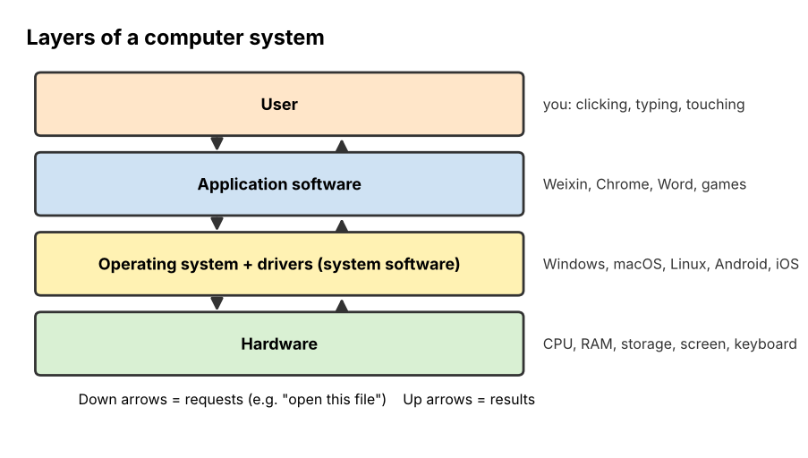

# 01 Software Overview and OS

**Chapter:** Chapter 3: Software & Algorithms  
**Status:** Drafted (V2.0, 3 Nov 2026). Examples checked by running a short program. Waiting for second-member review (see `tasks.md`, T16).  
**Owner / reviewer:** see `tasks.md` (T10)  
**Prerequisites:** None (basic computer use: files, apps, a browser).  
**Draft note:** Prepared with Claude assistance (AI-use record AI-5). The round-robin trace was run with a short program. Team members must review and be able to explain every part.

## Learning Objectives

After this topic, a beginner can:

1. Distinguish **system software** from **application software** and give examples of each.
2. List the main jobs of an **operating system (OS)**: managing processes, memory, files and devices, and providing a user interface.
3. Explain in simple steps what happens when you open a document.
4. Trace how an OS shares one processor between several programs using **round-robin scheduling**.
5. Describe in a few sentences how operating systems developed (batch → time-sharing → personal → mobile).

## Explanation

### Hardware and software

A computer has two sides:

- **Hardware** is the physical part you can touch: the processor (CPU), memory (RAM), storage (SSD or hard disk), screen, keyboard.
- **Software** is the set of instructions, called **programs**, that tells the hardware what to do.

Hardware without software can do nothing useful. Software without hardware has nothing to run on.

### Two kinds of software

| | System software | Application software |
|---|---|---|
| Purpose | Runs and looks after the computer itself | Helps the user do a task |
| Who uses it directly | Mostly other programs; the user rarely notices it | The user |
| Examples | Operating systems (Windows, macOS, Linux, Android, iOS); **device drivers** (small programs that let the OS talk to a printer or graphics card); **utilities** (antivirus, disk cleanup, backup tools) | Word processors, web browsers, Weixin (WeChat), games, music players, Photoshop |
| Can the computer work without it? | No (without an OS, apps cannot run) | Yes (the computer still runs; you just cannot do that task) |

A simple test: *"Does this program do a job for me, or does it keep the computer working?"* The first is application software; the second is system software.

*Figure 1. The layers of a computer system. The user works with applications. Applications ask the operating system for what they need (memory, files, the screen). Only the OS and drivers talk to the hardware directly.*

### What an operating system does

The **operating system** is the main piece of system software. It sits between the applications and the hardware, like a manager in a busy office who shares out rooms, desks and the printer so that workers do not fight over them.

| OS job | What it means | Everyday example |
|---|---|---|
| **Process management** | Starts and stops programs and shares the CPU between them | Music keeps playing while you type a document |
| **Memory management** | Gives each running program its own part of RAM and takes it back when the program closes | Closing a big game frees memory, so other apps run faster |
| **File management** | Organises data into files and folders on storage and controls who may open them | Saving `essay.docx` in `Documents` |
| **Device management** | Controls input and output devices through drivers | Plugging in a USB mouse and it simply works |
| **User interface** | Gives the user a way to control the computer: a graphical interface (windows, icons) or a command line | The desktop, the Start menu, the phone home screen |
| **Security** | Checks who is using the computer and what they are allowed to do | Login password, app permissions on a phone |

### Processes and the CPU

A **program** is a file of instructions sitting on storage. When you start it, it becomes a **process**: a program that is running, with its own memory and its own place in the CPU's queue.

A simple processor core can carry out only one process at a time, yet you see many apps working "at once". The OS creates this illusion by switching very quickly between processes, many times per second. Each process moves between three main **states**:

- **Ready:** waiting for its turn on the CPU.
- **Running:** using the CPU now.
- **Waiting (blocked):** paused until something happens, such as a file finishing loading or the user pressing a key.

One simple and fair way to share the CPU is **round-robin scheduling**. Each process gets a short, fixed slice of time called a **time quantum**. When its slice ends, it goes to the back of the ready queue (if it still has work), and the next process runs.

### Memory

**RAM** is fast working memory, but it is limited and is emptied when the power goes off. Storage (SSD) is slower but keeps data permanently. When you open a program, the OS copies the parts it needs from storage into RAM. The OS also keeps processes apart, so one crashing app cannot overwrite another app's memory. When RAM is full, many operating systems use **virtual memory**: they move parts of RAM that are not being used right now out to storage, then bring them back when needed. This lets more programs run, but too much of it makes the computer slow.

### How operating systems developed

| Period | Kind of OS | Main idea |
|---|---|---|
| 1950s | **Batch** systems | Jobs on punched cards were collected and run one after another; no interaction while a job ran |
| 1960s–1970s | **Time-sharing** systems, such as **UNIX** (Bell Labs, 1969) | Many users at terminals share one computer; the OS switches between them quickly |
| 1980s–1990s | **Personal computer** OS with graphical interfaces (Mac OS 1984, Windows) | One user, windows and a mouse |
| 1991 onward | **Linux**, a free UNIX-like system | Open source; now runs most web servers and is the base of Android |
| 2007 onward | **Mobile** OS (iOS 2007, Android 2008) | Touch screens, app stores, strong control of battery and app permissions |

UNIX is worth remembering: its ideas (files in a tree of folders, small tools combined together, a command line called a *shell*) live on in Linux, macOS and Android.

## Worked Example 1: What happens when you double-click `essay.docx`

1. **User interface.** The OS notices the double-click on the file icon.
2. **File management.** The OS finds `essay.docx` in the folder tree and sees from the `.docx` ending that Word (or another word processor) opens it.
3. **Process management.** The OS starts the word processor as a new process and puts it in the ready queue.
4. **Memory management.** The OS gives the new process a block of RAM and copies the program's instructions and the document's contents into it.
5. **Device management.** The OS, through the graphics driver, draws the program's window on the screen and sends your key presses to it.
6. **Security.** If the file belongs to another user, the OS checks whether you are allowed to open it before step 2 continues.

Notice that the word processor never touches the disk or the screen directly. It asks the OS, and the OS does the work.

## Worked Example 2: Round-robin scheduling

Three processes are ready, in this order. Each number is how many milliseconds (ms) of CPU work it still needs. The time quantum is **2 ms**.

| Process | CPU time needed |
|---|---|
| Music | 3 ms |
| Browser | 5 ms |
| Editor | 2 ms |

| Time (ms) | Running | What happens next | Ready queue afterwards |
|---|---|---|---|
| 0–2 | Music | Used 2 ms, needs 1 more → back of queue | Browser, Editor, Music |
| 2–4 | Browser | Used 2, needs 3 more → back of queue | Editor, Music, Browser |
| 4–6 | Editor | Used 2, needs 0 → **finishes at 6** | Music, Browser |
| 6–7 | Music | Used its last 1 ms → **finishes at 7** | Browser |
| 7–9 | Browser | Used 2, needs 1 more → back of queue | Browser |
| 9–10 | Browser | Used its last 1 ms → **finishes at 10** | (empty) |

Finishing order: **Editor (6 ms), Music (7 ms), Browser (10 ms)**. The short job (Editor) finished early even though it was last in the queue. This is why round-robin feels responsive: no single long job can hold the CPU for long.

## Activity

1. **Sort the programs.** Label each as **S** (system software) or **A** (application software): (a) Windows 11, (b) Weixin, (c) a printer driver, (d) Google Chrome, (e) antivirus scanner, (f) Excel, (g) Android, (h) a disk-cleanup tool, (i) Spotify, (j) a calculator app.
2. **Match the OS job.** Which OS job (process, memory, file, device, user interface, security) is shown in each situation?
   - (a) A phone asks "Allow this app to use your camera?"
   - (b) You plug in headphones and the sound moves to them.
   - (c) You drag a photo into a new folder.
   - (d) A video keeps downloading while you scroll a web page.
   - (e) A computer with many tabs open slows down, and closing tabs speeds it up.
3. **Trace round-robin.** Processes in the queue: **Game 4 ms, Chat 1 ms, Upload 3 ms**. Time quantum = 2 ms. Fill in a table like Worked Example 2. In what order do they finish, and at what times?
4. **Explain a decision.** A friend says: "The OS is just the desktop picture and icons." Write two sentences explaining why this is incomplete.

## Answer

1. S: (a) Windows 11, (c) printer driver, (e) antivirus, (g) Android, (h) disk cleanup. A: (b) Weixin, (d) Chrome, (f) Excel, (i) Spotify, (j) calculator. *Note:* antivirus and disk cleanup are **utilities**, which most textbooks class as system software because they look after the computer rather than do a user task.
2. (a) Security. (b) Device management. (c) File management. (d) Process management (two processes share the CPU). (e) Memory management (each tab uses RAM; when RAM is full, the OS moves data to slower storage).
3. 0–2 Game (needs 2 more, to back) → queue Chat, Upload, Game; 2–3 Chat (**finishes at 3**) → queue Upload, Game; 3–5 Upload (needs 1 more) → queue Game, Upload; 5–7 Game (**finishes at 7**) → queue Upload; 7–8 Upload (**finishes at 8**). Order: **Chat 3 ms, Game 7 ms, Upload 8 ms.**
4. The desktop is only the **user interface**, one of the OS's jobs. The OS also runs and switches between programs, shares out memory, stores files and controls devices, mostly without the user seeing it.

## Common Misunderstandings

- *"An app and a process are the same thing."* An app is the program file; a process is a running copy of it. Opening two Chrome windows can create several processes from one program.
- *"More RAM makes the CPU faster."* More RAM lets more programs stay in fast memory, which avoids slowdowns, but it does not make the processor itself calculate faster.
- *"Linux and UNIX are the same."* Linux was written from scratch in 1991 to *behave like* UNIX; it does not contain the original UNIX code.

## Quick Self-Check

1. Is a device driver system or application software? *(System software.)*
2. Name the OS job that decides which program uses the CPU next. *(Process management / scheduling.)*
3. In round-robin, what happens to a process whose time slice ends before it has finished? *(It goes to the back of the ready queue.)*

## How This Topic Will Be Reused

- **Study Guide / Test Bank:** chapter "Software and the Operating System"; questions on sorting programs, matching OS jobs, a round-robin trace.
- **PPT Slides:** Figure 1 (layers), the OS-jobs table, the double-click steps, the round-robin table built row by row.
- **Video Tutorial:** "What an operating system does" (planned tutorial 1): narrate the double-click walk-through, then the round-robin trace.

## References

1. Silberschatz, A., Galvin, P. B., & Gagne, G. (2018). *Operating System Concepts* (10th ed.). Wiley. (OS functions, process states, round-robin scheduling, virtual memory.)
2. Tanenbaum, A. S., & Bos, H. (2015). *Modern Operating Systems* (4th ed.). Pearson. (History of operating systems.)
3. Ritchie, D. M., & Thompson, K. (1974). The UNIX time-sharing system. *Communications of the ACM, 17*(7), 365–375. (UNIX.)
4. Foundations of CS & AI 2026, Chapter 3 course slides ("Software overview": system and application software; operating systems: evolution, process management, memory management).

*The double-click walk-through and the scheduling examples are the team's own.*
