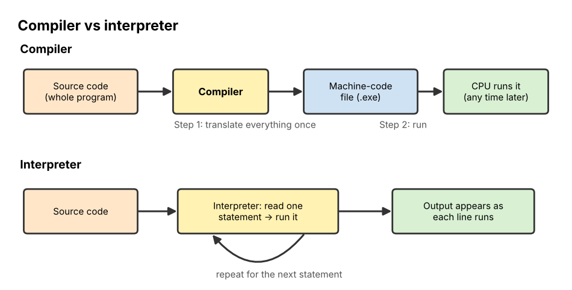

# 02 Programming Languages

**Chapter:** Chapter 3: Software & Algorithms  
**Status:** Drafted (V2.0, 3 Nov 2026). All programs were run and their outputs checked. Waiting for second-member review (see `tasks.md`, T16).  
**Owner / reviewer:** see `tasks.md` (T10)  
**Prerequisites:** Topic 01 (what a program and a CPU are).  
**Draft note:** Prepared with Claude assistance (AI-use record AI-5). Every program in this file was run in Python 3 and the outputs below are the real outputs.

## Learning Objectives

After this topic, a beginner can:

1. Explain why programming languages exist and name the three levels: **machine code**, **assembly language** and **high-level languages**.
2. Describe the difference between a **compiler** and an **interpreter**.
3. Name four **categories** (paradigms) of languages and give one example of each.
4. Read and trace a short program that uses a **variable**, a **condition** and a **loop**, and predict its output.

## Explanation

### Why we need programming languages

A CPU only understands **machine code**: long patterns of 0s and 1s, each pattern meaning one tiny instruction such as "add these two numbers". People find this almost impossible to read or write. A **programming language** is a precise, limited language that people can write and that can be translated into machine code. Unlike English, every statement has exactly one meaning, so the computer never has to guess.

### Three levels of language

| Level | What it looks like | Pros | Cons |
|---|---|---|---|
| **Machine code** (1940s) | `10110000 01100001` | Runs directly on the CPU; no translation | Unreadable; different for each type of CPU |
| **Assembly language** (late 1940s–1950s) | `LOAD A` · `ADD B` · `STORE C` | Short words (*mnemonics*) instead of binary; still very fast | One line ≈ one machine instruction, so programs are long; still tied to one CPU type |
| **High-level language** (1957 onward) | `c = a + b` | Close to human language and maths; one line does a lot; runs on many kinds of computer | Must be translated; the programmer has less direct control of the hardware |

*(The machine-code and assembly lines above are simplified illustrations, not the code of a real CPU.)*

The first widely used high-level language was **FORTRAN** (IBM, 1957), for science and engineering. **COBOL** (1959) was designed for business records. Later came **C** (1972), **C++** (1985), **Python** (1991), **Java** (1995) and **JavaScript** (1995).

### Translating: compiler vs interpreter



*Figure 1. A compiler translates the whole program once, before it runs. An interpreter translates and runs it one statement at a time.*

| | **Compiler** | **Interpreter** |
|---|---|---|
| How it works | Translates the whole **source code** into a machine-code file first; then that file is run | Reads one statement, runs it, then reads the next |
| Errors | Reports many errors before anything runs | Stops at the first error it reaches while running |
| Speed of the finished program | Usually faster | Usually slower |
| Typical examples | C, C++, Go, Rust | Python, JavaScript (in practice) |
| Analogy | Translating a whole book before printing it | A live interpreter at a meeting, sentence by sentence |

In reality many modern languages mix the two (Java and Python first turn code into an in-between form called *bytecode*). For beginners, the key idea is **translate everything first** vs **translate as you go**.

### Categories of languages (paradigms)

A **paradigm** is a style of writing programs.

| Paradigm | Main idea | Example languages | Tiny example idea |
|---|---|---|---|
| **Procedural / imperative** | A list of commands carried out in order, grouped into procedures | C, Pascal, (Python can do this) | "Do step 1, then step 2, then repeat step 3" |
| **Object-oriented** | Programs are built from **objects** that combine data and actions | Java, C++, Python | A `Student` object has a name and a method `enrol()` |
| **Functional** | Programs are built from functions that return results without changing stored data | Haskell, Lisp | `total = sum(map(square, numbers))` |
| **Logic / declarative** | You state facts and rules; the system works out the answer | **Prolog**, SQL | `parent(tom, ann).` then ask `?- parent(tom, X).` |

Logic programming connects directly to Chapter 4: **Prolog** (1972) was built for Symbolic AI, and its facts and rules work like the rule-based systems in Topic 10. **SQL** (Topic 04) is also declarative: you say *what* data you want, not *how* to find it.

### Common features of high-level languages

Almost every language you will meet has these building blocks. Examples use Python.

| Feature | Meaning | Python example |
|---|---|---|
| **Variable** | A named box that stores a value; the value can change | `score = 0` |
| **Data type** | The kind of value: whole number (integer), decimal number, text (string), True/False (Boolean) | `5`, `3.2`, `"Anu"`, `True` |
| **Assignment** | Put a value into a variable. `=` means "store", not "is equal" | `score = score + 1` |
| **Condition (selection)** | Do something only if a test is true | `if score > 50:` |
| **Loop (iteration)** | Repeat some statements | `for n in [4, 7, 2]:` or `while x > 1:` |
| **Function** | A named group of statements that can be reused | `def area(w, h): return w * h` |
| **Comment** | A note for humans, ignored by the computer | `# this is a comment` |

In Python, the lines that belong to an `if` or a loop are **indented** (moved right). Indentation is part of the language, not decoration.

## Worked Example: Tracing a five-line program

```python
total = 0
for n in [4, 7, 2]:
    if n > 3:
        total = total + n
print(total)
```

**What it does in words:** start a running total at 0; look at each number in the list; if the number is bigger than 3, add it to the total; finally show the total.

To **trace** a program means to follow it line by line and write down the value of every variable. This is how programmers check what a program will do before (or instead of) running it.

| Step | Line running | n | Test `n > 3` | total |
|---|---|---|---|---|
| 1 | `total = 0` | – | – | 0 |
| 2 | loop: first item | 4 | 4 > 3 is **True** | 0 + 4 = **4** |
| 3 | loop: second item | 7 | 7 > 3 is **True** | 4 + 7 = **11** |
| 4 | loop: third item | 2 | 2 > 3 is **False** | stays **11** |
| 5 | `print(total)` | – | – | prints **11** |

**Output:** `11`

## Activity

1. **Predict the output** of Program A. Then change `== 0` to `== 1` and predict again.

   ```python
   count = 0
   for i in range(1, 6):      # i takes the values 1, 2, 3, 4, 5
       if i % 2 == 0:         # % gives the remainder after dividing
           count = count + 1
   print(count)
   ```

2. **Predict the output** of Program B. Write the value of `x` after each pass of the loop. (`//` divides and rounds down, so `7 // 2` is 3.)

   ```python
   x = 10
   while x > 1:
       x = x // 2
       print(x)
   ```

3. **Find the error.** A student wants to add up only the numbers **below** 5 in `[4, 7, 2]` and expects the answer 6. Their program prints 7. What did they get wrong?

   ```python
   total = 0
   for n in [4, 7, 2]:
       if n > 5:
           total = total + n
   print(total)
   ```

4. **Compare.** You are writing (a) a game that must run as fast as possible, and (b) a quick script to rename 50 photos once. Would a compiled or an interpreted language suit each better? Give one reason for each.
5. **Classify.** Which paradigm best fits each line: (a) `SELECT name FROM Students WHERE year = 1` (b) a `Car` object with `speed` and `brake()` (c) `likes(anu, tea).`

## Answer

1. Program A counts the even numbers from 1 to 5: i = 2 and i = 4 → output **2**. With `== 1` it counts odd numbers 1, 3, 5 → output **3**.
2. Pass 1: 10 // 2 = **5** (5 > 1, continue). Pass 2: 5 // 2 = **2** (2 > 1, continue). Pass 3: 2 // 2 = **1** (1 > 1 is false, stop). Output, one per line: **5, 2, 1**.
3. The condition is `n > 5`, so only 7 is added and the result is 7. It should be `n < 5`, which adds 4 + 2 = **6**. This kind of mistake is called a **logic error**: the program runs, but does the wrong thing.
4. (a) **Compiled**: the whole program is translated to machine code in advance, so it usually runs faster. (b) **Interpreted**: you can write and run it immediately without a build step; speed does not matter for a one-time job.
5. (a) Declarative (SQL). (b) Object-oriented. (c) Logic (Prolog fact).

## Common Misunderstandings

- *"`=` means equals."* In most languages `=` means **store**. `total = total + n` would be nonsense in maths but is normal in programming: work out the right side, then store it on the left. Testing equality uses `==`.
- *"High-level means advanced or difficult."* It means *far from the hardware* and closer to human language, which usually makes it easier.
- *"A program that runs without crashing is correct."* Activity 3 runs perfectly and still gives the wrong answer.

## Quick Self-Check

1. Which translator reports errors in the whole program before it runs? *(A compiler.)*
2. Which paradigm does Prolog belong to, and which later topic uses the same idea? *(Logic programming; Topic 10, rule-based systems.)*
3. What is printed by `x = 3` then `x = x * 2` then `print(x)`? *(6)*

## How This Topic Will Be Reused

- **Study Guide / Test Bank:** chapter "Programming Languages"; predict-the-output and find-the-error questions from the activity.
- **PPT Slides:** three-levels table, Figure 1, paradigm table, the trace table revealed row by row.
- **Video Tutorial:** not selected as a separate video; the trace table may be reused as a short clip inside the algorithms tutorial.

## References

1. Brookshear, J. G., & Brylow, D. (2019). *Computer Science: An Overview* (13th ed.). Pearson. (Language generations, translation, paradigms.)
2. Sebesta, R. W. (2016). *Concepts of Programming Languages* (11th ed.). Pearson. (History of FORTRAN, COBOL and later languages; compilers and interpreters.)
3. Python Software Foundation. (2024). *The Python Tutorial*. https://docs.python.org/3/tutorial/ (Variables, `if`, `for`, `while`, `range`.)
4. Clocksin, W. F., & Mellish, C. S. (2003). *Programming in Prolog* (5th ed.). Springer. (Logic programming.)
5. Foundations of CS & AI 2026, Chapter 3 course slides ("Programming languages: evolution, categories, features").

*All programs and traces are the team's own examples.*
