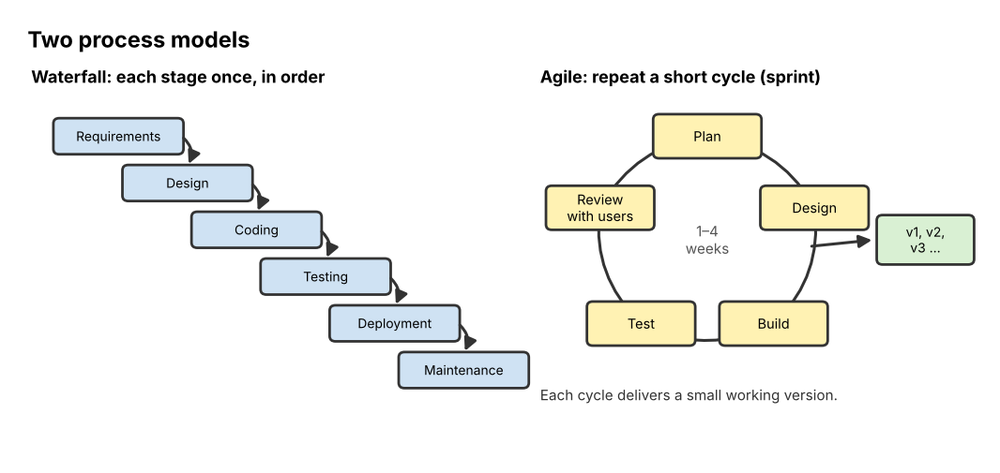

# 03 Software Engineering

**Chapter:** Chapter 3: Software & Algorithms  
**Status:** Drafted (V2.0, 3 Nov 2026). Waiting for second-member review (see `tasks.md`, T16).  
**Owner / reviewer:** see `tasks.md` (T10)  
**Prerequisites:** Topic 02 (what a program is; that programs can contain errors).  
**Depth:** Brief introduction (B) as agreed in the project plan: the main ideas, one worked example and one activity, without detailed methodologies.  
**Draft note:** Prepared with Claude assistance (AI-use record AI-5). Team members must review and be able to explain every part.

## Learning Objectives

After this topic, a beginner can:

1. Name and order the stages of the **software development life cycle (SDLC)**.
2. Compare the **waterfall** and **agile** process models and say when each fits.
3. Explain what **modularity** is and why it helps.
4. Explain why **testing** and **maintenance** matter, and write simple test cases.
5. Describe what **version control** (such as Git and GitHub) does and why teams use it.

## Explanation

### Why "engineering"?

Writing a 10-line program for yourself is easy. Building an app used by millions, written by hundreds of people over years, is not. **Software engineering** is the organised, disciplined way of building software so that it does what users need, works reliably, and can be changed later. Just as civil engineers plan, design and inspect a bridge before and after building it, software engineers plan, design, test and maintain software.

### The software development life cycle (SDLC)

| Stage | Key question | Output |
|---|---|---|
| 1. **Requirements** | *What* must the software do, and for whom? | A list of requirements, agreed with users |
| 2. **Design** | *How* will it be organised? Which parts (modules), screens and data? | Diagrams, screen sketches, module plan |
| 3. **Implementation (coding)** | Write the program | Source code |
| 4. **Testing** | Does it work correctly? Does it meet the requirements? | Test results, bug reports, fixes |
| 5. **Deployment** | Put it in users' hands | Released app or website |
| 6. **Maintenance** | Fix bugs found later, adapt to new devices, add features | Updates (version 1.1, 1.2, 2.0 …) |

A **requirement** can be *functional* (what the system does: "the timer counts down 25 minutes") or *non-functional* (how well it does it: "the app opens in under 2 seconds").

Errors are much cheaper to fix early. A misunderstanding found while writing requirements costs a conversation; the same misunderstanding found after release can mean redesigning, recoding, retesting and re-releasing.

### Two process models

*Figure 1. Waterfall goes through each stage once, in order. Agile repeats a short cycle many times, delivering a small working piece of software each time.*

| | **Waterfall** | **Agile** (for example, Scrum) |
|---|---|---|
| How it flows | Each stage is finished and signed off before the next starts | Work is split into short cycles (**iterations** or **sprints**, often 1–4 weeks); each cycle plans, builds, tests and shows a working piece |
| Requirements | Fixed at the start | Expected to change; updated after each cycle |
| User involvement | Mainly at the start and end | Frequent: users see and comment on every cycle |
| Fits well when | Requirements are clear and stable; changes are costly (e.g. safety systems) | Requirements are unclear or change often (e.g. a new phone app) |
| Main risk | Problems in requirements are found very late | Less predictable final scope and date; needs disciplined teams |

The *Manifesto for Agile Software Development* (2001) summed up the agile values, such as "responding to change over following a plan".

### Modularity

**Modularity** means splitting a program into separate parts, called **modules**, each doing one job and connecting to the others through a clear **interface** (the agreed way of calling it). Think of LEGO bricks: each brick is simple, and the studs are the interface that lets bricks fit together.

Benefits: different people can build different modules at the same time; each module can be tested on its own; a module can be replaced or reused without rewriting everything.

### Quality assurance and testing

**Quality assurance (QA)** is everything a team does to make sure the software is good enough: reviews, standards and, above all, **testing**.

- A **bug** is an error in the software.
- A **test case** gives an **input**, the **expected output**, and then compares it with the **actual output**. If they differ, the test fails and a bug has been found.
- Levels of testing: **unit testing** (one module alone) → **integration testing** (modules working together) → **system testing** (the whole program) → **acceptance testing** (real users check that it meets their requirements).
- Good testers also try **boundary** and **unexpected** inputs: zero, negative numbers, empty fields, very large values.

### Version control

**Version control** records every change to a project's files, who made it, when and why. **Git** is the most widely used version-control tool; **GitHub** is a website that stores Git projects online so a team can share them.

| Term | Meaning | In our team |
|---|---|---|
| **Repository (repo)** | The project folder plus its full history | `BRICKSTORM-AI` |
| **Commit** | A saved snapshot of changes with a message explaining them | "Add worked example to Topic 04" |
| **Branch** | A separate line of work, so you can change things without disturbing the main version | A branch for drafting Topic 11 |
| **Merge** | Combine a branch's changes back into the main branch | Merging the Topic 11 branch into `main` |
| **Pull request** | A request on GitHub to merge a branch, where teammates review the changes first | Our rule: another member reviews before merging |

Why teams use it: nobody overwrites anyone else's work; mistakes can be undone by going back to an earlier commit; the history shows who contributed what. This module's own repository is a real example: each topic was drafted and revised through commits.

## Worked Example: A study-timer app through the life cycle

| Stage | What happens for the study timer |
|---|---|
| Requirements | Functional: the user can start a 25-minute study session and a 5-minute break; an alarm sounds at the end; the app counts sessions finished today. Non-functional: works on a phone; easy to use with one hand. |
| Design | Modules: **Timer** (counts down), **Alarm** (plays the sound), **History** (stores the number of sessions), **Screen** (buttons and display). Sketch of one screen with a big Start button. |
| Implementation | Each module is coded; the Screen calls Timer's `start(25)`. |
| Testing | Unit test of Timer: input `start(1)` → expected: reaches 0 after 60 seconds. Boundary test: what if the user presses Start twice? Expected: the timer does not run twice as fast. Acceptance test: five classmates use it for a day. |
| Deployment | Released to an app store as version 1.0. |
| Maintenance | Users report the alarm is silent when the phone is on vibrate (bug fix in 1.1); users ask for custom session lengths (new feature in 1.2). |

**Waterfall or agile?** For a small app whose users will have new ideas once they try it, agile fits better: release a basic timer in the first sprint, then add history and custom lengths in later sprints based on feedback.

## Activity

1. **Which stage should have caught it?** For each problem, name the SDLC stage where it should have been prevented or found, and say why.
   - (a) A finished library app lets students borrow books, but the library actually needed it to handle *room bookings*.
   - (b) The app crashes when a user leaves the "age" box empty.
   - (c) An app built for Android 12 stops working after a phone update to a newer version.
   - (d) Two programmers wrote modules that both work alone, but together the dates come out in different formats (day/month vs month/day).
   - (e) Every screen has a different layout and the app is confusing to use.
2. **Write test cases.** A function `grade(score)` should return "Pass" for scores 60–100 and "Fail" for 0–59. Write four test cases (input, expected output), including at least two boundary values.
3. **Choose a model.** For each project, choose waterfall or agile and give one reason: (a) control software for a hospital radiation machine, where every requirement is set by law; (b) a new social app for students, where the team is not sure which features people will like.
4. **Version control.** Two teammates both edit Topic 05 on the same day. Explain how branches and a pull request stop one person's work from overwriting the other's.

## Answer

1. (a) **Requirements**: the team built the wrong thing because it never confirmed what the users needed. (b) **Testing** (unit/system testing with an empty or unexpected input). (c) **Maintenance**: adapting software to a changed environment is normal maintenance work. (d) **Integration testing** (and a clearer interface in design: agree one date format). (e) **Design**: a consistent screen design should have been planned; acceptance testing with users would also reveal it.
2. Example answer: `grade(75)` → "Pass"; `grade(30)` → "Fail"; `grade(60)` → "Pass" (boundary); `grade(59)` → "Fail" (boundary). Good extra cases: `grade(0)` → "Fail", `grade(100)` → "Pass", and an invalid input such as `grade(-5)` or `grade(120)` → the requirements must say what should happen (for example, an error message). Spotting that the requirement is missing is a good answer.
3. (a) **Waterfall**: the requirements are fixed and well known, and every change must be carefully checked and documented for safety. (b) **Agile**: the requirements are uncertain, so short cycles with user feedback let the team change direction cheaply.
4. Each person works on their **own branch**, so their commits do not change `main`. When finished, each opens a **pull request**; a teammate reviews the changes, and Git merges them. If both changed the *same lines*, Git reports a **merge conflict** and a person decides which version to keep, instead of one silently overwriting the other.

## Common Misunderstandings

- *"Testing proves the program has no bugs."* Testing can show that bugs exist, but it cannot prove there are none; it only checks the cases you tried.
- *"Maintenance is just fixing bugs."* It also includes adapting to new systems and adding features, and over the life of a program it is often the largest share of the work.
- *"Agile means no planning."* Agile teams plan constantly, just in short cycles instead of one big plan at the start.
- *"Git and GitHub are the same."* Git is the version-control tool on your computer; GitHub is one website that hosts Git repositories.

## Quick Self-Check

1. Put in order: testing, requirements, maintenance, design, coding. *(Requirements, design, coding, testing, maintenance.)*
2. Which model delivers working software in short repeated cycles? *(Agile.)*
3. What does a commit message record? *(What changed and why.)*

## How This Topic Will Be Reused

- **Study Guide / Test Bank:** short chapter; questions from the "which stage?" activity and the test-case task.
- **PPT Slides:** SDLC table, Figure 1, study-timer table.
- **Video Tutorial:** not selected for video (brief topic).

## References

1. Sommerville, I. (2016). *Software Engineering* (10th ed.). Pearson. (Life cycle, waterfall and agile models, testing levels, maintenance.)
2. Beck, K., et al. (2001). *Manifesto for Agile Software Development*. https://agilemanifesto.org/
3. Chacon, S., & Straub, B. (2014). *Pro Git* (2nd ed.). Apress. https://git-scm.com/book (Commits, branches, merging.)
4. Foundations of CS & AI 2026, Chapter 3 course slides ("Software engineering: development process models, modularity, quality assurance").

*The study-timer example, the activity problems and the `grade` function are the team's own.*
