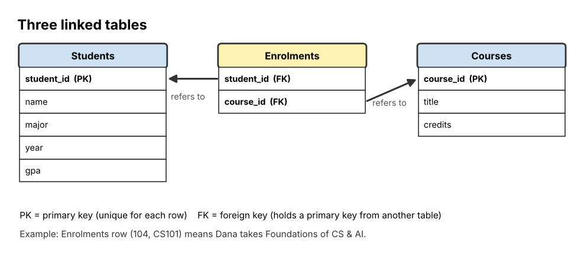

# 04 Databases and SQL

**Chapter:** Chapter 3: Software & Algorithms  
**Status:** Drafted (V2.0, 3 Nov 2026). Every query was run in SQLite and the results below are the real results. Waiting for second-member review (see `tasks.md`, T16).  
**Owner / reviewer:** see `tasks.md` (T10)  
**Prerequisites:** Topic 01; the idea of a table with rows and columns (like a spreadsheet).  
**Draft note:** Prepared with Claude assistance (AI-use record AI-5). All tables and queries were loaded into SQLite and run to check the answers.

## Learning Objectives

After this topic, a beginner can:

1. Explain what a **database**, a **table**, a **row** (record) and a **column** (field) are.
2. Explain what a **primary key** and a **foreign key** are, and how they link tables.
3. Name the three classic **database models** (hierarchical, network, relational).
4. Read and write basic **SQL** queries with `SELECT`, `FROM`, `WHERE`, `ORDER BY`, and predict which rows they return.
5. Explain why a database is better than one big spreadsheet for shared data.

## Explanation

### What is a database?

A **database** is an organised collection of data stored so that it can be searched, updated and shared easily. A **database management system (DBMS)** is the software that stores the database and answers requests: for example MySQL, PostgreSQL, SQLite, Oracle and Microsoft SQL Server. Every time you log in to an app, check your grades online or search a shop's products, a DBMS is answering a request in the background.

### Why not just one big spreadsheet?

| Problem with one shared spreadsheet | How a database handles it |
|---|---|
| The same information is typed many times (a student's major on every course row), so copies disagree | Each fact is stored **once** and linked where needed |
| Two people editing at once overwrite each other | The DBMS manages many users at the same time safely |
| Anyone can type anything (e.g. "two" in a number column) | Each column has a **data type** and rules |
| Slow with millions of rows | Designed to search huge amounts of data quickly |
| Everyone sees everything | Different users get different permissions |

### Database models

A **database model** is the way the data is organised.

| Model | Structure | Era / example |
|---|---|---|
| **Hierarchical** | A tree: each record has one parent (like folders inside folders) | 1960s; IBM IMS |
| **Network** | Records linked in a web; a record may have several parents | Late 1960s–1970s; CODASYL systems |
| **Relational** | Data in **tables**, linked by shared values (keys) | Proposed by E. F. Codd in 1970; most databases today |

Today the relational model dominates. (Newer "NoSQL" databases store data as documents or key–value pairs for special needs, but they are beyond this module.)

### Tables, rows, columns, keys

In a **relational database**:

- A **table** stores data about one kind of thing (students, courses).
- A **row** (also called a **record**) is one item: one student.
- A **column** (also called a **field** or **attribute**) is one property: name, major.
- A **primary key** is a column whose value is **unique** for every row and never empty, so each row can be identified exactly. Names are poor keys (two students can share a name), so we use an ID.
- A **foreign key** is a column in one table that holds the primary key of a row in *another* table. It creates a **relationship** between the tables.

**Students** (primary key: `student_id`)

| student_id | name | major | year | gpa |
|---|---|---|---|---|
| 101 | Anu | Computer Science | 1 | 3.6 |
| 102 | Bat | Economics | 2 | 3.1 |
| 103 | Chen | Computer Science | 2 | 3.9 |
| 104 | Dana | Design | 1 | 3.4 |
| 105 | Erdene | Economics | 1 | 2.8 |
| 106 | Fatima | Computer Science | 3 | 3.2 |

**Courses** (primary key: `course_id`)

| course_id | title | credits |
|---|---|---|
| CS101 | Foundations of CS & AI | 3 |
| EC110 | Intro to Economics | 3 |
| DS120 | Visual Design | 2 |

**Enrolments** (foreign keys: `student_id` → Students, `course_id` → Courses)

| student_id | course_id |
|---|---|
| 101 | CS101 |
| 102 | EC110 |
| 103 | CS101 |
| 104 | DS120 |
| 104 | CS101 |
| 105 | EC110 |
| 106 | CS101 |



*Figure 1. Enrolments links Students and Courses. Each student's name is stored only once, in Students; Enrolments stores only the ID.*

### SQL: asking the database questions

**SQL** (Structured Query Language, often said "sequel") is the standard language for relational databases. It is **declarative**: you describe *what* you want, and the DBMS works out *how* to find it (see Topic 02).

A basic **query** has this shape:

```sql
SELECT column1, column2     -- which columns to show
FROM   TableName            -- which table to look in
WHERE  condition            -- which rows to keep (optional)
ORDER BY column ASC|DESC;   -- how to sort the result (optional)
```

| Part | Meaning |
|---|---|
| `SELECT name, gpa` | Show only these columns. `SELECT *` means all columns |
| `FROM Students` | Look in this table |
| `WHERE major = 'Economics'` | Keep only rows where the condition is true. Text goes in single quotes; numbers do not |
| Comparison | `=`, `<>` (not equal), `<`, `>`, `<=`, `>=` |
| Combine conditions | `AND` (both true), `OR` (at least one true), `NOT` — the same logic as Topic 08 |
| `ORDER BY gpa DESC` | Sort the result; `ASC` = smallest first (the default), `DESC` = largest first |

**How to work out a query by hand:** (1) go to the table in `FROM`; (2) go through it row by row and keep the rows where `WHERE` is true; (3) sort the kept rows by `ORDER BY`; (4) show only the columns in `SELECT`.

## Worked Example: Find all Computer Science students

**Question:** Which students major in Computer Science, best GPA first?

```sql
SELECT name, gpa
FROM Students
WHERE major = 'Computer Science'
ORDER BY gpa DESC;
```

1. **FROM:** look at the Students table (6 rows).
2. **WHERE:** check each row. 101 Anu ✔, 102 Bat ✘ (Economics), 103 Chen ✔, 104 Dana ✘, 105 Erdene ✘, 106 Fatima ✔. Three rows kept.
3. **ORDER BY gpa DESC:** sort the kept rows from highest GPA: Chen 3.9, Anu 3.6, Fatima 3.2.
4. **SELECT:** show only name and gpa.

**Result:**

| name | gpa |
|---|---|
| Chen | 3.9 |
| Anu | 3.6 |
| Fatima | 3.2 |

**Using a relationship (preview).** "Who is enrolled in CS101?" needs two tables: find the IDs in Enrolments where `course_id = 'CS101'` (101, 103, 104, 106), then look up each ID in Students: **Anu, Chen, Dana, Fatima**. SQL does this with a `JOIN`, which is beyond the basic level of this module, but the idea (follow the key from one table to the other) is what matters.

## Activity

Use the Students table above.

1. **Predict the rows.** Write the result of each query.
   - (a) `SELECT name FROM Students WHERE year = 1;`
   - (b) `SELECT name, major FROM Students WHERE gpa >= 3.5;`
   - (c) `SELECT name FROM Students WHERE major = 'Economics' AND year = 1;`
   - (d) `SELECT * FROM Students WHERE major = 'Design' OR gpa < 3.0;`
2. **Write the query.** Write SQL for: "Show the names and GPAs of **all** students, lowest GPA first."
3. **Find the error.** This query gives an error. Why? `SELECT name FROM Students WHERE major = Economics;`
4. **Keys.** (a) Why is `name` a poor choice of primary key for Students? (b) In Enrolments, student 104 appears twice. Is that a problem? (c) Using the Enrolments and Courses tables, which courses is Dana taking?

## Answer

1. (a) **Anu, Dana, Erdene** (the three year-1 students). (b) **Anu – Computer Science; Chen – Computer Science** (3.6 and 3.9; Fatima's 3.2 is too low). (c) **Erdene** (Bat is Economics but year 2). (d) Two full rows: **104 Dana Design 1 3.4** (matches the first condition) and **105 Erdene Economics 1 2.8** (matches the second). With `OR`, one true condition is enough.
2. `SELECT name, gpa FROM Students ORDER BY gpa ASC;` → Erdene 2.8, Bat 3.1, Fatima 3.2, Dana 3.4, Anu 3.6, Chen 3.9. (`ASC` may be left out because it is the default.)
3. `Economics` is text, so it must be in single quotes: `'Economics'`. Without quotes the DBMS thinks it is the name of a column, and there is no such column.
4. (a) Two students can have the same name, so it would not identify one row exactly. A primary key must be unique. (b) No. `student_id` is a primary key in Students, but in Enrolments it is a **foreign key**, and one student can enrol in several courses. (c) Dana is 104 → Enrolments rows with 104 → DS120 and CS101 → **Visual Design** and **Foundations of CS & AI**.

## Common Misunderstandings

- *"A database is just a big spreadsheet."* Tables look similar, but a database adds keys, relationships, data types, safe multi-user access and fast searching.
- *"`WHERE` chooses columns."* `WHERE` chooses **rows**; `SELECT` chooses **columns**.
- *"`AND` gives more results than `OR`."* It is the opposite: `AND` needs both conditions, so it usually keeps fewer rows.

## Quick Self-Check

1. What property must every primary key value have? *(It must be unique and not empty.)*
2. Which part of a query sorts the results? *(`ORDER BY`.)*
3. Who proposed the relational model, and when? *(E. F. Codd, 1970.)*

## How This Topic Will Be Reused

- **Study Guide / Test Bank:** chapter "Databases and SQL"; predict-the-rows questions using the same Students table.
- **PPT Slides:** spreadsheet vs database table, Figure 1, the four-step "how to read a query" method animated on the worked example.
- **Video Tutorial:** not selected for video in Stage 2.

## References

1. Codd, E. F. (1970). A relational model of data for large shared data banks. *Communications of the ACM, 13*(6), 377–387.
2. Elmasri, R., & Navathe, S. B. (2016). *Fundamentals of Database Systems* (7th ed.). Pearson. (Database models, keys, SQL.)
3. SQLite. (2024). *SQL As Understood By SQLite: SELECT*. https://www.sqlite.org/lang_select.html (Used to run and check all queries.)
4. Foundations of CS & AI 2026, Chapter 3 course slides ("Databases: database models, relational databases, SQL").

*The Students, Courses and Enrolments tables are the team's own invented data.*
