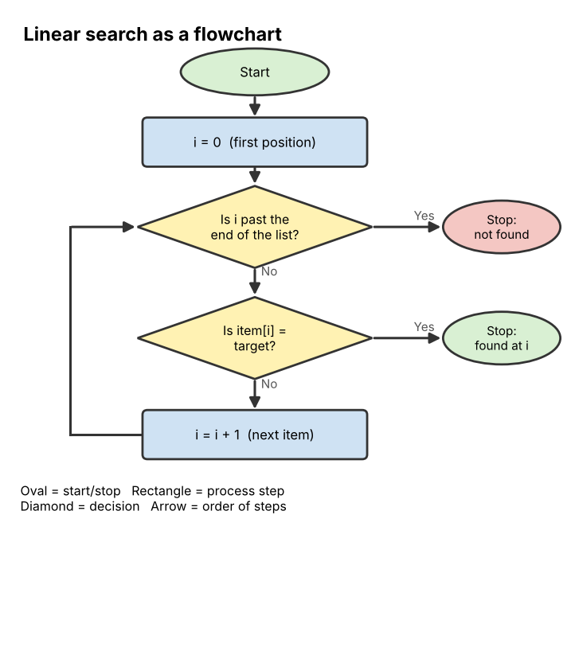

# 05 Algorithms

**Chapter:** Chapter 3: Software & Algorithms  
**Status:** Drafted (V2.0, 3 Nov 2026). V1.0 covered searching only; V2.0 adds features and representation of algorithms, sorting, iteration and recursion, and efficiency. All traces were checked by running the code. Waiting for second-member review (see `tasks.md`, T16).  
**Owner / reviewer:** see `tasks.md` (T10)  
**Prerequisites:** Topic 02 (variables, conditions, loops). A **list** is explained below in one line; Topic 06 covers it in depth.  
**Draft note:** Prepared with Claude assistance (AI-use records AI-4 and AI-5). Every trace and count below was produced by running the code and compared with the hand trace.

## Learning Objectives

After this topic, a beginner can:

1. Define **algorithm** and name its five features.
2. Represent an algorithm in **natural language**, **pseudocode** and a **flowchart**.
3. Carry out **linear search** and **binary search** by hand, and explain why binary search needs a **sorted** list.
4. Carry out **bubble sort** and **selection sort** by hand.
5. Explain the difference between **iteration** and **recursion** and trace a simple recursive function.
6. Compare algorithms by counting steps, and explain intuitively why some grow much faster than others.

## Explanation

### What is an algorithm?

An **algorithm** is a finite list of exact steps that solves a problem. A recipe is similar, but an algorithm must be clear enough that a computer could follow it with no guessing. Every program from Topic 02 carries out one or more algorithms.

A good algorithm has five **features** (Knuth's classic list):

| Feature | Meaning | What breaks it |
|---|---|---|
| **Finiteness** | It always stops after a finite number of steps | "Keep adding 1 until the number is negative" never stops |
| **Definiteness** | Every step is exact, with only one meaning | "Add a little salt" |
| **Input** | It takes zero or more values to work on | – |
| **Output** | It produces at least one result | A procedure that never reports anything |
| **Effectiveness** | Every step is simple enough to actually be done | "Write down every digit of π" |

### Three ways to write an algorithm

**Problem:** find whether a target value is in a list.

**1. Natural language:** Look at the items one by one from the start. If an item equals the target, say where it is and stop. If you reach the end, say "not found".

**2. Pseudocode** (structured, program-like English that is not tied to one language):

```text
for each position i from 0 to the last position
    if item[i] = target then
        return i
return "not found"
```

**3. Flowchart:** a diagram with standard shapes: an oval for **start/stop**, a rectangle for a **process** step, a diamond for a **decision** (yes/no question), and arrows for the order.



*Figure 1. Linear search as a flowchart. The loop is the arrow going back up from "move to the next item".*

### Searching

A **list** is an ordered collection of items; each position has a number called an **index**, starting at 0. **Searching** means finding where a target value is in a list (or finding that it is not there).

- **Linear search:** check items one by one from the start until you find the target or reach the end. Works on any list.
- **Binary search:** works only on a **sorted** list. Look at the middle item. If it equals the target, stop. If the target is bigger, discard the left half; if smaller, discard the right half. Repeat on the half that is left. Each step halves the search area.

For binary search, keep two markers, **low** and **high**, for the part still being searched, and compute **mid** = (low + high) // 2 (round down). Stop with "not found" when low > high.

```python
def binary_search(items, target):
    low, high = 0, len(items) - 1
    while low <= high:
        mid = (low + high) // 2
        if items[mid] == target:
            return mid          # found: return the index
        elif items[mid] < target:
            low = mid + 1       # search the right half
        else:
            high = mid - 1      # search the left half
    return -1                   # not found
```

### Sorting

**Sorting** means putting items in order (smallest to largest, A to Z). Sorting matters because sorted data is much faster to search (binary search) and easier for people to read.

**Bubble sort.** Go through the list comparing each **neighbouring pair**. If they are in the wrong order, **swap** them. After one full **pass**, the largest value has "bubbled" to the end. Repeat passes on the unsorted part. Stop when a pass makes no swaps.

**Selection sort.** Find the **smallest** item in the unsorted part and swap it into the first unsorted position. Now one more item is in its final place. Repeat.

```python
def bubble_sort(items):
    n = len(items)
    for p in range(n - 1):                 # one pass each time
        swapped = False
        for i in range(n - 1 - p):         # the sorted end is skipped
            if items[i] > items[i + 1]:
                items[i], items[i + 1] = items[i + 1], items[i]   # swap
                swapped = True
        if not swapped:
            break                          # no swaps: already sorted
    return items
```

### Iteration and recursion

There are two ways to make an algorithm repeat work:

- **Iteration:** use a loop (`for`, `while`) to repeat steps. All the algorithms above are iterative.
- **Recursion:** a function **calls itself** on a smaller version of the same problem. Every recursive function needs:
  1. a **base case**, a simple case answered directly, which stops the recursion; and
  2. a **recursive case**, which makes the problem smaller and calls the function again.

Example: the **factorial** of n, written n!, is n × (n−1) × … × 1. So 4! = 4 × 3 × 2 × 1 = 24. Notice that 4! = 4 × 3!, so the problem contains a smaller copy of itself.

```python
def factorial(n):          # recursive version
    if n <= 1:             # base case
        return 1
    return n * factorial(n - 1)   # recursive case: smaller problem

def factorial_loop(n):     # iterative version, same result
    result = 1
    for k in range(2, n + 1):
        result = result * k
    return result
```

Without a base case, a recursive function would call itself forever (in practice the program crashes with a "maximum recursion depth" error). The computer keeps track of the unfinished calls on a **call stack**, a stack like the one in Topic 06: the last call started is the first to finish.

### Efficiency: how fast does the work grow?

We compare algorithms by counting their basic steps (such as comparisons) as the input gets bigger, not by timing them on one computer.

| List size *n* | Linear search, worst case (checks) | Binary search, worst case (checks) |
|---|---|---|
| 8 | 8 | 4 |
| 1,000 | 1,000 | 10 |
| 1,000,000 | 1,000,000 | 20 |
| 1,000,000,000 | 1,000,000,000 | 30 |

Linear search grows in step with *n*: double the list, double the work. Binary search grows by only **one** check each time the list doubles, because each check halves what is left. Bubble and selection sort compare roughly every pair of items, so for *n* items they need about *n*²/2 comparisons: 10 items → 45 comparisons, 1,000 items → about 500,000. That is why real systems use faster sorting methods (such as merge sort) for big data.

*(Computer scientists write these growth rates in "Big O" notation: linear search is O(n), binary search O(log n), bubble sort O(n²). The notation is optional in this module; the idea of how the work grows is what matters.)*

## Worked Example 1: Binary search

List (sorted): `[3, 8, 12, 19, 25, 31, 40, 47]` with indexes 0 to 7. **Target: 31.**

| Step | low | high | mid | items[mid] | Decision |
|---|---|---|---|---|---|
| 1 | 0 | 7 | 3 | 19 | 19 < 31, so discard the left half: low = 4 |
| 2 | 4 | 7 | 5 | 31 | Found at index 5 |

Binary search needed **2 checks**. Linear search would check 3, 8, 12, 19, 25, 31, which is **6 checks**.

## Worked Example 2: Bubble sort

Sort `[5, 2, 9, 1, 6]`.

**Pass 1** (compare each neighbouring pair):

| Compare | Swap? | List after |
|---|---|---|
| 5 and 2 | Yes | [2, 5, 9, 1, 6] |
| 5 and 9 | No | [2, 5, 9, 1, 6] |
| 9 and 1 | Yes | [2, 5, 1, 9, 6] |
| 9 and 6 | Yes | [2, 5, 1, 6, **9**] |

9, the largest, is now in its final place.

| Pass | List after the pass | Swaps |
|---|---|---|
| 1 | [2, 5, 1, 6, **9**] | 3 |
| 2 | [2, 1, 5, **6, 9**] | 1 |
| 3 | [1, 2, **5, 6, 9**] | 1 |
| 4 | [1, 2, 5, 6, 9] | 0 → stop, sorted |

## Worked Example 3: Tracing recursion

`factorial(4)`:

```text
factorial(4) = 4 * factorial(3)          waits
    factorial(3) = 3 * factorial(2)      waits
        factorial(2) = 2 * factorial(1)  waits
            factorial(1) = 1             base case reached
        factorial(2) = 2 * 1 = 2         returns 2
    factorial(3) = 3 * 2 = 6             returns 6
factorial(4) = 4 * 6 = 24                returns 24
```

The calls go **down** until the base case, then the answers come back **up** in reverse order (last call started, first call finished).

## Activity

1. **Binary search.** Using `[3, 8, 12, 19, 25, 31, 40, 47]`: (a) search for **8**; fill in a table like Worked Example 1. How many checks? (b) Search for **10**. What happens, and how many checks before you can say "not found"?
2. **Why sorted?** Why would binary search give wrong results on `[12, 3, 47, 8]`?
3. **Bubble sort.** Sort `[4, 3, 1, 2]` with bubble sort. Write the list after each pass. How many passes until a pass makes no swaps?
4. **Selection sort.** Sort `[29, 10, 14, 37, 13]` with selection sort. Write the list after each step.
5. **Recursion.** (a) Trace `factorial(5)`. (b) This function is meant to add 1 + 2 + … + n. What does `sum_to(4)` return? (c) What would happen if the line `if n == 0: return 0` were deleted?

   ```python
   def sum_to(n):
       if n == 0:
           return 0
       return n + sum_to(n - 1)
   ```

6. **Compare.** A phone contact list has 1,000,000 names in alphabetical order. At most how many checks does each search method need to find one name? Which would you choose and why?
7. **Spot the broken feature.** Which algorithm feature does each break? (a) "Pick a good number." (b) "Start at 1 and keep doubling until you reach 0."

## Answer

1. (a) Step 1: low 0, high 7, mid 3, value 19 > 8, so high = 2. Step 2: low 0, high 2, mid 1, value 8. Found at index 1 after **2 checks**. (b) Step 1: mid 3 (19) > 10, high = 2. Step 2: low 0, high 2, mid 1 (8) < 10, low = 2. Step 3: low 2, high 2, mid 2 (12) > 10, high = 1. Now low (2) > high (1), so **not found after 3 checks**.
2. The method assumes that everything left of the middle is smaller and everything right is bigger. In an unsorted list that is false, so discarding half the list can throw away the target.
3. Pass 1: [3, 1, 2, **4**]. Pass 2: [1, 2, **3, 4**]. Pass 3: [1, 2, 3, 4] with **no swaps**, so stop. **Three passes** (the third pass confirms the list is sorted).
4. Step 1: smallest is 10, swap with 29 → [10, 29, 14, 37, 13]. Step 2: smallest of the rest is 13, swap with 29 → [10, 13, 14, 37, 29]. Step 3: smallest of the rest is 14, already in place → [10, 13, 14, 37, 29]. Step 4: smallest of the rest is 29, swap with 37 → [10, 13, 14, 29, 37]. Sorted.
5. (a) factorial(5) = 5 × factorial(4) = 5 × 4 × factorial(3) = … = 5 × 4 × 3 × 2 × 1 = **120**. (b) sum_to(4) = 4 + sum_to(3) = 4 + 3 + sum_to(2) = 4 + 3 + 2 + sum_to(1) = 4 + 3 + 2 + 1 + sum_to(0) = 4 + 3 + 2 + 1 + 0 = **10**. (c) There would be **no base case**: sum_to(0) would call sum_to(−1), then sum_to(−2), forever, until the program crashes with a recursion-depth error. This breaks *finiteness*.
6. Linear search: up to **1,000,000** checks. Binary search: at most **20** checks. Choose binary search, because the list is already sorted.
7. (a) **Definiteness**: "good" is not exact. (b) **Finiteness**: doubling a positive number never reaches 0, so it never stops.

## Common Misunderstandings

- *"Binary search is always better."* It needs a sorted list. If the list is unsorted and you search only once, sorting first costs more than one linear search.
- *"Recursion is a loop with a different name."* Recursion solves a problem by solving smaller copies of the same problem; it needs a base case, and it uses the call stack.
- *"A faster computer fixes a slow algorithm."* For large inputs, a better algorithm (20 checks instead of 1,000,000) beats a faster machine.

## Quick Self-Check

1. Which flowchart shape is used for a yes/no decision? *(Diamond.)*
2. After the first pass of bubble sort, which item is guaranteed to be in its final place? *(The largest.)*
3. What are the two parts every recursive function needs? *(A base case and a recursive case.)*

## How This Topic Will Be Reused

- **Study Guide / Test Bank:** chapter "Algorithms"; tracing questions for binary search, bubble sort, selection sort and recursion; growth table for comparison questions.
- **PPT Slides:** features table, Figure 1 flowchart, binary-search table step by step, bubble-sort pass table, recursion call trace.
- **Video Tutorial:** "Binary search by hand" (planned tutorial 2), using Worked Example 1 and Activity 1. Bubble sort is a candidate for a second short clip.

## References

1. Cormen, T. H., Leiserson, C. E., Rivest, R. L., & Stein, C. (2022). *Introduction to Algorithms* (4th ed.). MIT Press. (Binary search, sorting, recursion, growth of functions.)
2. Knuth, D. E. (1997). *The Art of Computer Programming, Vol. 1: Fundamental Algorithms* (3rd ed.). Addison-Wesley. (The five features of an algorithm.)
3. Bhargava, A. Y. (2016). *Grokking Algorithms*. Manning. (Beginner-level explanations of binary search, selection sort, recursion and the call stack.)
4. Foundations of CS & AI 2026, Chapter 3 course slides ("Algorithms: features, representation, basic algorithms (sorting, searching), iteration and recursion").

*The lists, targets and traces are the team's own examples.*
