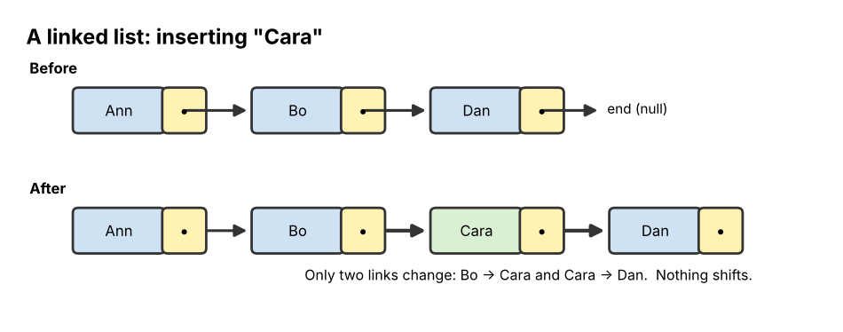
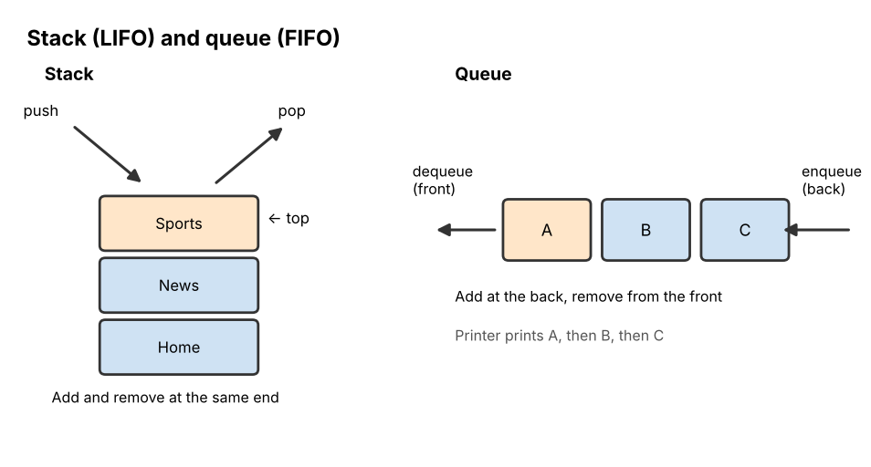
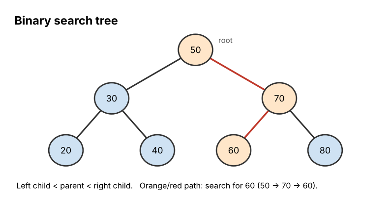

# 06 Data Structures

**Chapter:** Chapter 3: Software & Algorithms  
**Status:** Drafted (V2.0, 3 Nov 2026). Stack, queue and tree traces checked by running code. Waiting for second-member review (see `tasks.md`, T16).  
**Owner / reviewer:** see `tasks.md` (T10)  
**Prerequisites:** Topic 05 (lists and indexes; binary search).  
**Draft note:** Prepared with Claude assistance (AI-use record AI-5). Team members must review and be able to explain every part.

## Learning Objectives

After this topic, a beginner can:

1. Explain why the way data is organised affects how fast and how easily we can use it.
2. Describe an **array**, a **record**, a **linked list**, a **stack**, a **queue**, a **tree**, a **binary search tree** and a **graph**.
3. Trace **push/pop** on a stack and **enqueue/dequeue** on a queue.
4. Search a small binary search tree by hand.
5. Choose a suitable structure for a simple task and justify the choice.

## Explanation

### Why structure matters

A **data structure** is a way of organising data in memory so that it can be used efficiently. Think of a library: books thrown in a pile, books on shelves by number, and a card catalogue all hold the same books, but finding one takes very different amounts of time. Choosing the structure is choosing which operations (finding, adding, removing) will be fast.

Data structures and algorithms go together: binary search (Topic 05) only works because the data is stored as a *sorted array*.

### The main structures

| Structure | Picture | Key idea | Good at | Weak at |
|---|---|---|---|---|
| **Array** | A row of numbered boxes | Fixed-size sequence of items of the same type, each reached by its **index** (`a[3]`) | Jumping straight to any position | Inserting in the middle (everything after must shift) |
| **List** (dynamic array, e.g. Python list) | Array that can grow | Like an array but can change size | Same as array; easy to add at the end | Inserting at the front of a long list |
| **Record** (struct) | A form with labelled boxes | Groups **different kinds** of data about one thing under field names | Keeping related data together: `{name: "Anu", age: 19, gpa: 3.6}` | Not a collection by itself (use an array of records) |
| **Linked list** | A chain of boxes, each pointing to the next | Each **node** holds a value and a **pointer** (link) to the next node | Inserting or removing anywhere by changing links | Finding the 500th item (must walk from the start) |
| **Stack** | A pile of plates | **LIFO**: Last In, First Out. Add (**push**) and remove (**pop**) only at the **top** | Undo, Back button, matching brackets, recursion (Topic 05) | Reaching items at the bottom |
| **Queue** | A line at a canteen | **FIFO**: First In, First Out. Add (**enqueue**) at the **back**, remove (**dequeue**) from the **front** | Fair waiting lines: print jobs, messages, CPU ready queue (Topic 01) | Reaching items in the middle |
| **Tree** | A family tree / folder tree | Nodes linked **parent → children**, starting from one **root**; no loops | Hierarchies: folders, organisation charts | – |
| **Binary search tree (BST)** | A tree where each node has at most 2 children | Left child smaller, right child bigger | Fast searching, adding and removing in sorted data | Gets slow if it becomes very lopsided |
| **Graph** | A map of cities and roads | **Nodes** (vertices) joined by **edges**; any node can link to any other; loops allowed | Networks: maps, friendships, web links | – |

The record, array and linked list are *how* data is laid out; the stack and queue are defined by *rules* for adding and removing; trees and graphs model *relationships*.

### Linked list

*Figure 1. Each node stores a value and a pointer to the next node. To insert "Cara" between "Bo" and "Dan", only two links change: Bo now points to Cara, and Cara points to Dan. Nothing needs to shift.*

### Stack and queue

*Figure 2. A stack adds and removes at the same end (the top). A queue adds at the back and removes from the front.*

### Trees and binary search trees

Tree words: the top node is the **root**; a node directly below another is its **child**, and the one above is its **parent**; nodes with no children are **leaves**. Folders on your computer form a tree (Topic 01).

A **binary tree** is a tree where every node has **at most two** children, called left and right. A **binary search tree** adds one rule: for every node, all values in its **left** subtree are **smaller** and all values in its **right** subtree are **bigger**. To search, start at the root and go left or right at each step, just like binary search halves a list.

*Figure 3. A binary search tree built by inserting 50, 30, 70, 20, 40, 60, 80 in that order. Searching for 60: 60 > 50 → go right to 70; 60 < 70 → go left to 60. Found in 3 checks.*

### Graphs

A **graph** is the most general structure: nodes connected by edges, with no parent/child rule. Edges may have a direction (one-way streets, "follows" on social media) and a **weight** (distance, cost). Searching through graphs is the heart of Topic 11 (planning and search), and the semantic networks of Topic 09 are graphs with labelled edges.

## Worked Example: The browser Back button is a stack

The browser keeps the pages you visit on a stack. The page on **top** is the one you are looking at.

| Action | Operation | Stack (bottom → top) | Page shown |
|---|---|---|---|
| Open Home | push Home | [Home] | Home |
| Click News | push News | [Home, News] | News |
| Click Sports | push Sports | [Home, News, Sports] | Sports |
| Press Back | pop (removes Sports) | [Home, News] | News |
| Click Weather | push Weather | [Home, News, Weather] | Weather |
| Press Back | pop (removes Weather) | [Home, News] | News |
| Press Back | pop (removes News) | [Home] | Home |

Back always returns to the **most recently** visited page that is still on the stack: last in, first out. Notice that after pressing Back from Sports and then visiting Weather, Sports is gone. That matches how real browsers behave.

**Compare with a queue.** Three documents are sent to one printer: A, then B, then C. The printer queue is [A, B, C] (front → back). It prints A first (dequeue), then B, then C: first in, first out. A stack here would print C first, which would be unfair to the person who sent A.

## Activity

1. **Trace a stack.** Start with an empty stack. Carry out: push 5, push 8, pop, push 2, push 7, pop, pop. What is on the stack at the end, and which values were popped, in order?
2. **Trace a queue.** Start with an empty queue. Carry out: enqueue Anu, enqueue Bat, dequeue, enqueue Chen, enqueue Dana, dequeue. Who is still waiting, in order from the front?
3. **Search a BST.** Using Figure 3: (a) list the nodes visited when searching for 40; (b) list the nodes visited when searching for 65, and say how you know it is not there.
4. **Insert into a BST.** Insert 35 into the tree in Figure 3. Where does it go?
5. **Choose a structure.** Choose the best structure for each task and give one reason: (a) the Undo history in a text editor; (b) jobs waiting for a shared printer; (c) a family tree; (d) a shopping list you read from top to bottom; (e) one student's name, age and major kept together; (f) cities and the roads between them, for a route-planning app.
6. **Find the error.** A student says: "A queue is a good structure for the Back button, because pages are stored in the order they were visited." What is wrong with this?

## Answer

1. push 5 → [5]; push 8 → [5, 8]; pop → removes **8** → [5]; push 2 → [5, 2]; push 7 → [5, 2, 7]; pop → removes **7** → [5, 2]; pop → removes **2** → [5]. **Stack at the end: [5]. Popped in order: 8, 7, 2.**
2. enqueue Anu → [Anu]; enqueue Bat → [Anu, Bat]; dequeue → Anu leaves → [Bat]; enqueue Chen → [Bat, Chen]; enqueue Dana → [Bat, Chen, Dana]; dequeue → Bat leaves → [Chen, Dana]. **Still waiting: Chen, then Dana.**
3. (a) 50 → (40 < 50, go left) 30 → (40 > 30, go right) **40**. Found after 3 checks. (b) 50 → (65 > 50, right) 70 → (65 < 70, left) 60 → (65 > 60, go right) — 60 has **no right child**, so 65 is **not in the tree**. We know because a BST would have to store 65 exactly there.
4. 35 < 50 → left to 30; 35 > 30 → right to 40; 35 < 40 → left of 40, which is empty. **35 becomes the left child of 40.**
5. (a) **Stack**: Undo reverses the most recent change first (LIFO). (b) **Queue**: jobs are printed in the order they arrived (FIFO), which is fair. (c) **Tree**: each person has parents above and children below; it is a hierarchy. (Strictly, real family trees with two parents per child are graphs, but a tree is the usual simple model.) (d) **List/array**: an ordered sequence read from start to end. (e) **Record**: different kinds of data (text, number) about one thing under field names. (f) **Graph**: any city can connect to many others, and roads can form loops.
6. A queue would remove the **oldest** page first, so pressing Back on the Sports page would jump to Home, the first page visited. Back must return the **most recent** previous page, which needs LIFO, i.e. a **stack**. Both store pages in visiting order; the difference is **which end you remove from**.

## Common Misunderstandings

- *"Stacks and queues store data differently."* Both can be built from the same array or linked list. What differs is the **rule** for removing items.
- *"A tree in computing grows upward."* By convention the root is drawn at the **top** and the tree grows downward.
- *"Arrays and linked lists are equally fast for everything."* Arrays jump straight to any index; linked lists must walk link by link, but they insert and remove without shifting.

## Quick Self-Check

1. Which structure is LIFO? Which is FIFO? *(Stack; queue.)*
2. In a BST, where are values smaller than a node stored? *(In its left subtree.)*
3. Which structure groups different kinds of data about one thing under field names? *(A record.)*

## How This Topic Will Be Reused

- **Study Guide / Test Bank:** chapter "Data Structures"; stack/queue trace questions, BST search, and "choose a structure" questions.
- **PPT Slides:** the structures table split over several slides, Figures 1–3, the Back-button table animated row by row.
- **Video Tutorial:** not selected as a separate tutorial in Stage 2; the Back-button stack may appear as a short clip in the algorithms tutorial.

## References

1. Cormen, T. H., Leiserson, C. E., Rivest, R. L., & Stein, C. (2022). *Introduction to Algorithms* (4th ed.). MIT Press. (Stacks, queues, linked lists, binary search trees, graphs.)
2. Goodrich, M. T., Tamassia, R., & Goldwasser, M. H. (2013). *Data Structures and Algorithms in Python*. Wiley. (Beginner-friendly treatment of each structure in Python.)
3. Foundations of CS & AI 2026, Chapter 3 course slides ("Data structures: arrays, records, linked list, stacks, queues, trees, binary trees, graphs").

*The browser, printer and tree examples are the team's own.*
