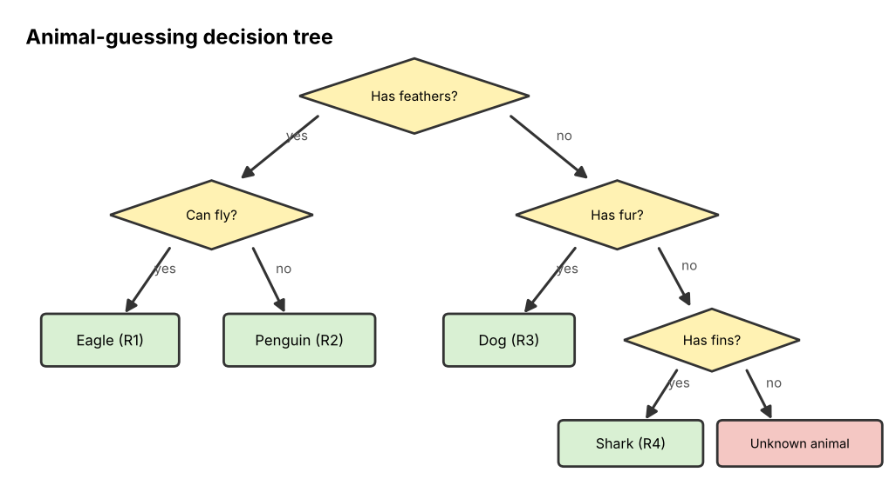

# 07 Intro to Symbolic AI

**Chapter:** Chapter 4: Symbolic AI  
**Status:** Drafted (V2.0, 3 Nov 2026). Waiting for second-member review (see `tasks.md`, T16).  
**Owner / reviewer:** see `tasks.md` (T10)  
**Prerequisites:** None required. Topics 02 (conditions) and 06 (trees) help.  
**Draft note:** Prepared with Claude assistance (AI-use record AI-5). Historical dates were checked against the references below. Team members must review and be able to explain every part.

## Learning Objectives

After this topic, a beginner can:

1. Explain what **artificial intelligence (AI)** and **Symbolic AI** are.
2. Describe the main idea that thinking can be done by **manipulating symbols with rules**.
3. Compare Symbolic AI with **data-driven AI** (machine learning) and say where each works well.
4. Give at least two historical examples of Symbolic AI and place them on a timeline.
5. Follow a small set of rules to reach a conclusion, as a Symbolic AI program does.

## Explanation

### What is AI?

**Artificial intelligence (AI)** is the field of building computer systems that do tasks which would need intelligence if a person did them: reasoning, planning, understanding language, recognising objects, making decisions.

There are two big families of approaches:

- **Symbolic AI**: people write knowledge down explicitly as **symbols** (words, names, numbers) and **rules**, and the program **reasons** with them.
- **Data-driven AI** (also called **machine learning**): the program is given many examples and **learns patterns** from them by adjusting numbers inside a model; nobody writes the rules by hand.

### The core idea of Symbolic AI

A **symbol** is something that stands for something else: the word `cat` stands for a real cat; `raining` stands for the fact that it is raining. Symbolic AI rests on an idea stated by Allen Newell and Herbert Simon, the **physical symbol system hypothesis** (1976): a system that can store symbols and change them by rules has what it needs to act intelligently.

So a Symbolic AI system has three ingredients:

1. **Symbols** that represent things in the world: `penguin`, `has_feathers`, `can_fly`.
2. **Knowledge** written using those symbols: facts (`Tweety is a penguin`) and rules (`IF X is a bird THEN X has feathers`).
3. A **reasoning procedure** that applies the rules to the facts to produce new facts or decisions.

This is why Symbolic AI is sometimes called **rule-based AI**, **logic-based AI** or **GOFAI** ("Good Old-Fashioned AI", a nickname from the philosopher John Haugeland, 1985). The rest of Chapter 4 looks at each ingredient in turn:

| Topic | Question it answers |
|---|---|
| 08 Logic and Reasoning | How do we reason correctly with true/false statements? |
| 09 Knowledge Representation | How do we store knowledge as symbols? |
| 10 Rule-Based and Expert Systems | How does a program apply rules to facts to reach a conclusion? |
| 11 Planning and Search | How does a program find a sequence of actions to reach a goal? |
| 12 Symbolic NLP | How can grammar rules help a program handle language? |

### Symbolic AI vs data-driven AI

| | **Symbolic AI** | **Data-driven AI (machine learning)** |
|---|---|---|
| Where the knowledge comes from | Written by human experts as rules | Learned automatically from many examples |
| How knowledge is stored | Readable symbols and rules | Millions of numbers (weights) inside a model |
| Can it explain its answer? | Yes: it can list the rules it used | Usually hard to explain |
| Needs lots of data? | No | Yes |
| Handles messy, uncertain input (photos, speech, handwriting)? | Poorly | Well |
| Changing its behaviour | Edit or add a rule | Retrain on new data |
| Typical uses | Tax and legal rule checking, configuration, planning, games with clear rules, route finding | Image recognition, speech recognition, translation, chatbots like ChatGPT |

Many modern systems are **hybrid (mixed)**: for example, AlphaGo (2016) combined neural networks that learned from data with a symbolic **tree search** over possible moves.

### A short history

| Year | Event |
|---|---|
| 1956 | The **Dartmouth workshop** gives the field the name "artificial intelligence" (the term was coined by John McCarthy in the 1955 proposal). |
| 1956 | **Logic Theorist** (Newell, Shaw and Simon) proves theorems from *Principia Mathematica*, often called the first AI program. |
| 1957–1959 | **General Problem Solver** (Newell and Simon) tries to solve any problem stated as goals and rules. |
| 1966 | **ELIZA** (Joseph Weizenbaum) chats using keyword rules (see Topic 12). |
| 1965 onward | **DENDRAL** (Stanford) identifies chemical molecules from measurements: the first expert system. |
| 1972 | **Prolog**, a programming language based on logic (see Topic 02). |
| 1970s | **MYCIN** suggests treatments for blood infections with several hundred rules (see Topic 10). |
| 1980s | Expert systems become a business, e.g. **XCON/R1** at Digital Equipment Corporation. |
| Late 1980s | An "**AI winter**": expert systems prove expensive to build and maintain, and funding falls. |
| 1997 | IBM's **Deep Blue** beats world chess champion Garry Kasparov, using massive search plus a hand-built evaluation of positions. |
| 2010s onward | Machine learning dominates, but symbolic methods remain in route planning, scheduling, verification and hybrid systems. |

## Worked Example: An animal-guessing program

The program knows four animals: **eagle, penguin, dog, shark**. A person thinks of one, and the program asks yes/no questions. Its knowledge is four IF-THEN rules:

| Rule | IF | THEN |
|---|---|---|
| R1 | has feathers AND can fly | it is an **eagle** |
| R2 | has feathers AND cannot fly | it is a **penguin** |
| R3 | has fur | it is a **dog** |
| R4 | has fins | it is a **shark** |

The program asks questions in a fixed order, which forms a **decision tree** (a tree from Topic 06):

*Figure 1. Each diamond is a yes/no question. Each leaf is a conclusion produced by one rule.*

**Run: the person is thinking of a penguin.**

1. Program: "Does it have feathers?" Person: **yes**. New fact: *has feathers*.
2. Program: "Can it fly?" Person: **no**. New fact: *cannot fly*.
3. R2's conditions (has feathers AND cannot fly) are both true facts → R2 **fires**.
4. Program: "**It is a penguin.**" If asked *why*, it can answer: "Because it has feathers and cannot fly (rule R2)."

Three things to notice: every step is a readable symbol; the program can **explain** its answer; and it knows **nothing** outside its four rules. If the person thinks of a frog, the answers are no feathers, no fur, no fins, and no rule fires, so the program cannot answer. That brittleness is a typical limit of Symbolic AI.

## Activity

1. **Run the program.** The person thinks of a **shark**. Write the questions asked, the answers, the facts added, and the rule that fires.
2. **Extend the knowledge.** Add the **frog** to the program. Write one new rule (R5) using a new symbol, and say where in Figure 1 a new question would go.
3. **Classify.** Label each system **S** (mainly symbolic), **D** (mainly data-driven) or **M** (mixed), and give a reason:
   - (a) A tax website that applies the official tax rules to your income.
   - (b) A spam filter trained on 100,000 emails that users marked as spam or not spam.
   - (c) A GPS app that finds the shortest route on a road map.
   - (d) Face unlock on a phone.
   - (e) AlphaGo.
   - (f) MYCIN.
4. **Explain a decision.** A hospital wants a system that recommends a drug dose, and doctors must be able to check *why* each recommendation was made. A bank wants a system that recognises handwritten cheque amounts. Which approach suits each better, and why?

## Answer

1. "Does it have feathers?" **no** → fact: no feathers. "Does it have fur?" **no** → fact: no fur. "Does it have fins?" **yes** → fact: has fins. **R4 fires**: it is a shark.
2. Example: **R5: IF has no feathers AND has no fur AND has no fins AND lives on land and in water THEN it is a frog.** A new question "Does it live on land and in water?" goes where "Does it have fins?" is answered **no** (where the tree currently says "unknown animal"). Any rule that separates the frog from the other four animals using checkable facts is acceptable.
3. (a) **S**: the tax rules are written by people and applied exactly. (b) **D**: it learns what spam looks like from labelled examples. (c) **S**: it searches a map graph with an exact procedure (Topic 11). (d) **D**: it learns to recognise faces from many images. (e) **M**: learned neural networks plus symbolic tree search. (f) **S**: hand-written IF-THEN rules from experts.
4. **Hospital → Symbolic AI** (or at least a symbolic part): every recommendation can be traced to rules that doctors can read and check. **Bank → data-driven AI**: handwriting varies endlessly and is hard to describe in rules, but there are many examples to learn from.

## Common Misunderstandings

- *"Symbolic AI is outdated and no longer used."* Rule engines, planners, route finders, and logic checkers are used every day, often inside hybrid systems.
- *"Symbolic AI programs learn from experience."* Classic symbolic systems do not learn; they only know what people wrote. Learning from data is the strength of machine learning.
- *"If a program uses IF statements, it is Symbolic AI."* Ordinary programs use IF statements too. Symbolic AI is about representing **knowledge** as symbols and rules and having a general **reasoning procedure** use them.

## Quick Self-Check

1. Name the three ingredients of a Symbolic AI system. *(Symbols, knowledge (facts and rules), a reasoning procedure.)*
2. Which approach can usually explain its answer by listing rules? *(Symbolic AI.)*
3. Which 1956 event named the field of AI? *(The Dartmouth workshop.)*

## How This Topic Will Be Reused

- **Study Guide / Test Bank:** opening chapter of Part 2; classification questions (S/D/M) and timeline questions.
- **PPT Slides:** symbolic vs data-driven table, timeline, Figure 1 decision tree.
- **Video Tutorial:** not selected as a separate video; the animal-guessing run may open the expert-systems tutorial.

## References

1. Russell, S., & Norvig, P. (2021). *Artificial Intelligence: A Modern Approach* (4th ed.). Pearson. (Chapter 1: history of AI, Dartmouth, Logic Theorist, GPS, expert systems, AI winter.)
2. Newell, A., & Simon, H. A. (1976). Computer science as empirical inquiry: Symbols and search. *Communications of the ACM, 19*(3), 113–126. (Physical symbol system hypothesis.)
3. Haugeland, J. (1985). *Artificial Intelligence: The Very Idea*. MIT Press. (The term "GOFAI".)
4. Campbell, M., Hoane, A. J., & Hsu, F. (2002). Deep Blue. *Artificial Intelligence, 134*(1–2), 57–83.
5. Silver, D., et al. (2016). Mastering the game of Go with deep neural networks and tree search. *Nature, 529*, 484–489. (AlphaGo as a hybrid system.)
6. Foundations of CS & AI 2026, Chapter 4 course slides.

*The animal-guessing rules and the activity systems are the team's own examples.*
