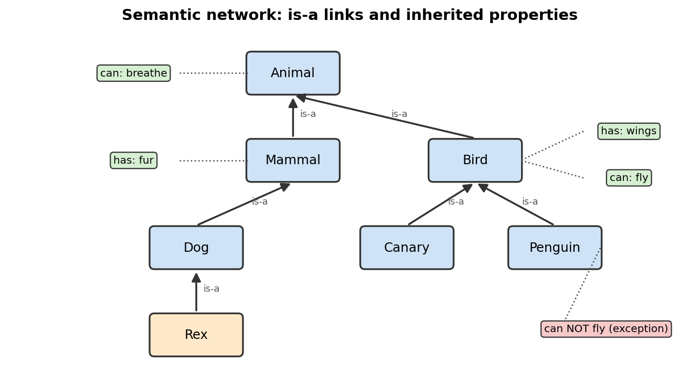

# 09 Knowledge Representation

**Chapter:** Chapter 4: Symbolic AI  
**Status:** Drafted (V1.0). Waiting for second-member review.  
**Proposed owner:** To be assigned (task T10)  
**Prerequisites:** Topics 07 and 08 (facts, rules, true/false statements).  
**Draft note:** Prepared with Claude assistance (AI-use record AI-4); to be checked by a team member.

## Learning Objectives

1. Explain why a computer needs knowledge written in a structured form.
2. Describe **facts**, **rules**, **semantic networks** and **frames**.
3. Use **inheritance** in a semantic network to answer a question.

## Explanation

**Knowledge representation** means writing what we know about the world in a form a computer can store and use for reasoning. A sentence such as "Dogs are mammals" is easy for people, but a program needs it in a fixed structure.

Four common forms:

- **Fact:** a single true statement, e.g. `Rex is a dog`.
- **Rule:** an IF-THEN statement, e.g. IF X is a dog THEN X is a mammal (used in Topic 10).
- **Semantic network:** a diagram of **nodes** (things or categories) joined by labelled **links**. The most common link is **is-a** (Rex is-a Dog).
- **Frame:** a record for one thing with named **slots**, e.g. Dog: {category: Mammal, legs: 4, sound: bark}.

**Inheritance:** an item automatically has the properties of the categories above it. If Rex is a Dog, and a Dog is a Mammal, and Mammals have fur, then Rex has fur, even though "Rex has fur" was never stored. This saves space and keeps knowledge consistent.

**Exceptions:** sometimes a lower node overrides a higher one. Birds can fly, but a penguin is a bird that cannot. The most specific information wins.

*Figure 1. Arrows show is-a links. Green tags are properties stored once at the top and inherited downward. The red tag on Penguin overrides the inherited "can fly".*

## Worked Example

Question: **Can Rex breathe?**

1. Start at **Rex**. It has no property "can breathe" stored.
2. Follow the is-a link up: Rex is-a **Dog**. Dog has no "can breathe".
3. Dog is-a **Mammal**. Mammal has "has: fur" but not "can breathe".
4. Mammal is-a **Animal**. Animal has "can: breathe". Found.
5. By inheritance, **Rex can breathe**.

A second question, **Can a penguin fly?** Start at Penguin: "can NOT fly" is stored there. We stop at the first match, so the answer is **no**, even though Bird says "can: fly".

## Activity

Use Figure 1.

1. Does Rex have fur? Write the path you followed.
2. Does a canary have wings? Does a canary fly?
3. Does Rex have wings?
4. Design question: add **Cat** to the network and give it one property of its own. Which links and properties must you add? What can a cat now inherit without storing it again?

## Answer

1. Yes. Rex → Dog → Mammal; Mammal stores "has: fur".
2. Canary → Bird; Bird stores "has: wings" and "can: fly". So yes to both.
3. No information. Rex → Dog → Mammal → Animal never reaches "has: wings", so the system cannot say Rex has wings. (A real system would treat this as "not known" or "no".)
4. Add the node **Cat** and one link **Cat is-a Mammal**. Add one own property, for example "sound: meow". Cat now inherits "has: fur" from Mammal and "can: breathe" from Animal without storing them again.

## References

1. Russell, S., & Norvig, P. (2021). *Artificial Intelligence: A Modern Approach* (4th ed.). Pearson. (Knowledge representation chapters.)
2. Minsky, M. (1975). A framework for representing knowledge. In P. H. Winston (Ed.), *The Psychology of Computer Vision* (pp. 211–277). McGraw-Hill. (Frames.)
3. Foundations of CS & AI 2026, Chapter 4 course slides.

*The animal network is the team's own example.*
