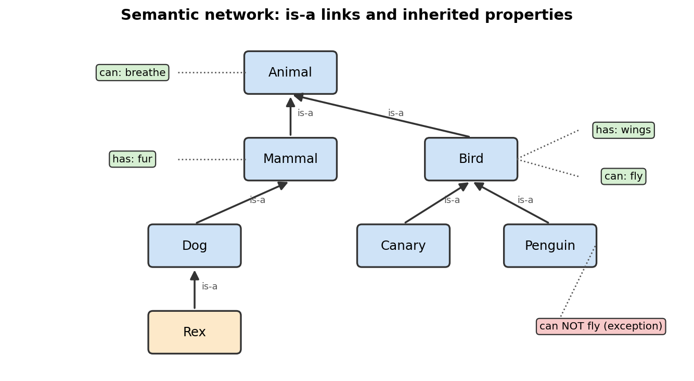

# 09 Knowledge Representation

**Chapter:** Chapter 4: Symbolic AI  
**Status:** Drafted (V2.0, 3 Nov 2026; V1.0 24 Oct). V2.0 adds a worked frame example, an "unknown vs false" note, misunderstandings, self-check and reuse notes. Waiting for second-member review (see `tasks.md`, T16).  
**Owner / reviewer:** see `tasks.md` (T10)  
**Prerequisites:** Topics 07 and 08 (facts, rules, true/false statements).  
**Draft note:** Prepared with Claude assistance (AI-use records AI-4 and AI-5); to be checked by a team member.

## Learning Objectives

1. Explain why a computer needs knowledge written in a structured form.
2. Describe **facts**, **rules**, **semantic networks** and **frames**.
3. Use **inheritance** in a semantic network to answer a question, including an exception.
4. Write a simple **frame** with slots and fill a slot by inheritance.
5. Choose a suitable representation for a piece of knowledge.

## Explanation

**Knowledge representation** means writing what we know about the world in a form a computer can store and use for reasoning. A sentence such as "Dogs are mammals" is easy for people, but a program needs it in a fixed structure.

Four common forms:

- **Fact:** a single true statement, e.g. `Rex is a dog`.
- **Rule:** an IF-THEN statement, e.g. IF X is a dog THEN X is a mammal (used in Topic 10).
- **Semantic network:** a diagram of **nodes** (things or categories) joined by labelled **links**. The most common link is **is-a** (Rex is-a Dog).
- **Frame:** a record for one thing with named **slots**, e.g. Dog: {category: Mammal, legs: 4, sound: bark}.

**Inheritance:** an item automatically has the properties of the categories above it. If Rex is a Dog, and a Dog is a Mammal, and Mammals have fur, then Rex has fur, even though "Rex has fur" was never stored. This saves space and keeps knowledge consistent.

**Exceptions:** sometimes a lower node overrides a higher one. Birds can fly, but a penguin is a bird that cannot. The most specific information wins.



*Figure 1. Arrows show is-a links. Green tags are properties stored once at the top and inherited downward. The red tag on Penguin overrides the inherited "can fly".*

### Comparing the four forms

| Form | Best for | Example | Weakness |
|---|---|---|---|
| Fact | Single pieces of information | `Rex is a dog` | Many separate facts are hard to organise |
| Rule | Knowledge of the form "if … then …" and decisions | IF X is a bird THEN X has wings | Thousands of rules become hard to maintain (Topic 10) |
| Semantic network | Categories and relationships; inheritance | Rex → Dog → Mammal → Animal | Link meanings must be agreed carefully |
| Frame | Everything about one kind of object in one place, with default values | Dog frame with slots | Hard to show actions and reasoning steps |

**Unknown is not the same as false.** If the knowledge base does not contain "Rex has wings", there are two possible policies: treat it as **false** (assume that anything not stored is false, called the *closed-world assumption*, as databases in Topic 04 do) or treat it as **unknown**. The choice changes the system's answers, so a designer must decide it on purpose.

## Worked Example

Question: **Can Rex breathe?**

1. Start at **Rex**. It has no property "can breathe" stored.
2. Follow the is-a link up: Rex is-a **Dog**. Dog has no "can breathe".
3. Dog is-a **Mammal**. Mammal has "has: fur" but not "can breathe".
4. Mammal is-a **Animal**. Animal has "can: breathe". Found.
5. By inheritance, **Rex can breathe**.

A second question, **Can a penguin fly?** Start at Penguin: "can NOT fly" is stored there. We stop at the first match, so the answer is **no**, even though Bird says "can: fly".

### Worked example with frames

Frames are like the records of Topic 06, with one extra power: a slot can be **inherited** from a more general frame.

```text
Frame: Bird                     Frame: Penguin
  is-a:  Animal                   is-a:  Bird
  wings: 2                        can_fly: no      (overrides Bird)
  can_fly: yes   (default)        habitat: cold coasts
  covering: feathers

Frame: Pingu
  is-a: Penguin
  age:  3
```

**Question: what is Pingu covered with, and can Pingu fly?**

1. Look in Pingu's frame for `covering`: not there. Go up the is-a link to **Penguin**: not there. Go up to **Bird**: `covering: feathers`. **Feathers.**
2. Look for `can_fly`: not in Pingu; found in **Penguin**: `no`. Stop at the first (most specific) value. **Pingu cannot fly**, even though Bird's default is "yes".

## Activity

Use Figure 1.

1. Does Rex have fur? Write the path you followed.
2. Does a canary have wings? Does a canary fly?
3. Does Rex have wings?
4. Design question: add **Cat** to the network and give it one property of its own. Which links and properties must you add? What can a cat now inherit without storing it again?

5. **Frames.** Using the frames in the worked example: (a) how many wings does Pingu have? Which frame supplied the answer? (b) Write a frame for **Ostrich** that inherits from Bird and overrides one slot.
6. **Choose a representation.** Which form fits best, and why? (a) "If a book is more than 14 days overdue, the student pays a fine." (b) Everything a phone shop needs to store about one phone model: brand, screen size, price, colour. (c) "A sparrow is a bird; a bird is an animal."

## Answer

1. Yes. Rex → Dog → Mammal; Mammal stores "has: fur".
2. Canary → Bird; Bird stores "has: wings" and "can: fly". So yes to both.
3. No information. Rex → Dog → Mammal → Animal never reaches "has: wings", so the system cannot say Rex has wings. (A real system would treat this as "not known" or "no".)
4. Add the node **Cat** and one link **Cat is-a Mammal**. Add one own property, for example "sound: meow". Cat now inherits "has: fur" from Mammal and "can: breathe" from Animal without storing them again.
5. (a) **2 wings**, inherited from the **Bird** frame (Pingu → Penguin → Bird). (b) Example: `Frame: Ostrich · is-a: Bird · can_fly: no · top_speed: 70 km/h`. Any frame with an is-a link to Bird and one slot that overrides a Bird default (such as can_fly) is correct.
6. (a) **Rule**: it is a condition leading to an action. (b) **Frame** (or a record): many named properties of one kind of object. (c) **Semantic network** with is-a links, so properties can be inherited.

## Common Misunderstandings

- *"Inheritance copies the properties down into every node."* Nothing is copied; the property is stored once and **found** by following the is-a links when needed.
- *"If a fact is not stored, it is false."* Only under the closed-world assumption. Many AI systems treat missing knowledge as **unknown**.
- *"The arrow in a semantic network can mean anything."* Each link label (is-a, has-part, eats) has one agreed meaning; mixing meanings leads to wrong inferences.

## Quick Self-Check

1. What is the most common link in a semantic network? *(is-a.)*
2. When a lower node and a higher node give different values, which wins? *(The lower, more specific node.)*
3. What are the named fields of a frame called? *(Slots.)*

## How This Topic Will Be Reused

- **Study Guide / Test Bank:** chapter "Knowledge Representation"; inheritance-path questions, frame-slot questions, choose-a-representation questions.
- **PPT Slides:** four-forms comparison table, Figure 1 with the inheritance path highlighted, Pingu frames.
- **Video Tutorial:** not selected as a separate video in Stage 2; Figure 1 is a candidate for a short animated clip in Stage 3.

## References

1. Russell, S., & Norvig, P. (2021). *Artificial Intelligence: A Modern Approach* (4th ed.). Pearson. (Knowledge representation chapters.)
2. Minsky, M. (1975). A framework for representing knowledge. In P. H. Winston (Ed.), *The Psychology of Computer Vision* (pp. 211–277). McGraw-Hill. (Frames.)
3. Foundations of CS & AI 2026, Chapter 4 course slides.

*The animal network is the team's own example.*
