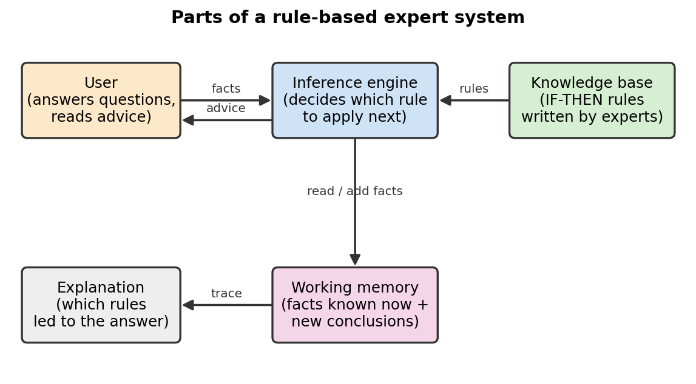
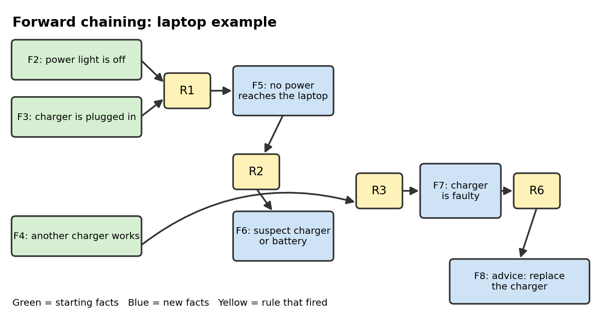

# 10 Rule-Based and Expert Systems

**Chapter:** Chapter 4: Symbolic AI  
**Status:** Drafted (V1.0). Waiting for second-member review (see the review record in the submission report).  
**Proposed owner:** Rawa Rashid (content lead)  
**Prerequisites:** Topics 07–09: what Symbolic AI is, what a fact and a rule are, and IF-THEN logic.  
**Draft note:** Prepared with Claude assistance (AI-use record AI-4). Examples were run and checked with a short program. Humans on the team must still review and be able to explain every part.

## Learning Objectives

After this topic, a beginner can:

1. Define **rule**, **fact**, **knowledge base**, **working memory**, **inference engine** and **expert system**.
2. Use **forward chaining** to work out, step by step, what a set of rules and facts lets us conclude.
3. Use **backward chaining** to test whether a goal can be proved.
4. Explain two strengths and two limits of rule-based systems.

## Explanation

### What is an expert system?

An **expert system** is a computer program that stores the knowledge of a human expert about one narrow subject and uses it to give advice, such as diagnosing a fault. Instead of learning from data, it follows rules that people wrote down. This is why it counts as **Symbolic AI**: the knowledge is written in readable symbols (words and rules), not hidden inside numbers.

Two historic examples:

- **MYCIN** (Stanford, 1970s) suggested antibiotic treatments for blood infections using several hundred IF-THEN rules. It was a research system and was not used in routine hospital care.
- **XCON** (also called R1, used by Digital Equipment Corporation in the 1980s) checked customer orders for computers and decided how to configure the parts.

### Key terms

| Term | Meaning | Laptop example |
|---|---|---|
| **Fact** | A statement that is known to be true right now | "The power light is off" |
| **Rule** | An IF-THEN statement: if all the conditions are true, the conclusion becomes true | IF power light is off AND charger is plugged in THEN no power reaches the laptop |
| **Knowledge base** | The collection of all rules, written by experts | Rules R1–R7 below |
| **Working memory** | The facts known at the moment, including new conclusions the system adds | F1–F4, then F5, F6 and so on |
| **Inference engine** | The part that decides which rule to apply next and adds the conclusion | The "reasoning" loop |
| **Firing a rule** | Using a rule whose conditions are all true to add its conclusion | R1 fires and adds F5 |

### How the parts fit together

*Figure 1. The user gives facts. The inference engine reads the rules from the knowledge base and the facts from working memory, adds new conclusions, and gives advice. Because every step is a rule, the system can also explain which rules led to its answer.*

### Two ways to reason

**Forward chaining** (data-driven) starts from the facts and works toward a conclusion.

1. Look for a rule whose conditions are all in working memory and whose conclusion is not yet known.
2. Fire it: add its conclusion to working memory.
3. Repeat from step 1.
4. Stop when a goal is reached or no rule can fire.

**Backward chaining** (goal-driven) starts from a goal and works backward to see whether the facts support it.

1. Pick the goal you want to prove.
2. If it is already a fact, it is proved.
3. Otherwise find a rule that concludes it. Its conditions become new sub-goals. Prove each one the same way.
4. If a sub-goal is not a fact and no rule concludes it, that route fails.

| | Forward chaining | Backward chaining |
|---|---|---|
| Starts from | Known facts | A goal |
| Direction | Facts → conclusions | Goal → facts |
| Good when | You have data and want to know "what follows?" | You have one question and want to know "can I prove this?" |
| Typical use | Monitoring, configuration | Diagnosis, question answering |

Both methods use the same rules and reach the same proved conclusions. They differ in the direction of search.

## Worked Example: A laptop will not start

**Knowledge base (rules)**

| Rule | IF | THEN |
|---|---|---|
| R1 | power light is off AND charger is plugged in | no power reaches the laptop |
| R2 | no power reaches the laptop | suspect charger or battery |
| R3 | suspect charger or battery AND another charger works | charger is faulty |
| R4 | suspect charger or battery AND another charger does not work | battery is faulty |
| R5 | power light is on AND screen is black | screen or display problem |
| R6 | charger is faulty | advice: replace the charger |
| R7 | battery is faulty | advice: replace the battery |

**Facts the user gives (working memory at the start)**

- F1: screen is black
- F2: power light is off
- F3: charger is plugged in
- F4: another charger works

### Forward chaining, step by step

| Cycle | Rules whose conditions are all true | Rule fired | New fact added |
|---|---|---|---|
| 1 | R1 (F2 and F3). R5 fails because the power light is not on | R1 | F5: no power reaches the laptop |
| 2 | R2 (F5) | R2 | F6: suspect charger or battery |
| 3 | R3 (F6 and F4). R4 fails because "another charger does not work" is not a fact | R3 | F7: charger is faulty |
| 4 | R6 (F7) | R6 | F8: advice: replace the charger |
| 5 | None (R7 needs "battery is faulty", which is not known) | Stop | — |

*Figure 2. How each rule turns facts into a new fact. F1 ("screen is black") is never used because only R5 needs it and R5 does not fire.*

### Backward chaining, step by step

**Goal:** advice: replace the charger.

1. The goal is not a fact. R6 concludes it, so we need **charger is faulty**.
2. R3 concludes "charger is faulty". It needs **suspect charger or battery** and **another charger works**.
3. "Another charger works" is a fact (F4). ✔
4. R2 concludes "suspect charger or battery". It needs **no power reaches the laptop**.
5. R1 concludes that. It needs **power light is off** (F2 ✔) and **charger is plugged in** (F3 ✔).
6. Every sub-goal is proved, so the goal is proved.

**A goal that fails:** advice: replace the battery. R7 needs "battery is faulty". R4 would conclude that, but it needs "another charger does not work". That is not a fact and no rule concludes it. The route fails, so the system cannot advise replacing the battery.

## Activity

Use the same rules R1–R7.

1. **Forward chaining.** The user gives only: F1 screen is black, F2 power light is **on**. Which rules fire and what does the system conclude? Does it give any advice?
2. **Improve the knowledge base.** Write one new rule, R8, so that the system in question 1 can give advice. Then run it again.
3. **Backward chaining.** Facts: power light is off, charger is plugged in, another charger does **not** work. Use backward chaining to test the goal "advice: replace the battery". Write each sub-goal.
4. **Apply the idea.** Choose a small everyday decision (for example "Should I bring an umbrella?" or "Which study room should I book?"). Write three facts and three IF-THEN rules that lead to a recommendation. Then write the forward-chaining steps for your example.

## Answer

1. Only R5 fires (power light is on AND screen is black). New fact: **screen or display problem**. No rule uses that fact, so the system stops with **no advice**. This shows a limit: the knowledge base has no rule for this case.
2. Example: **R8: IF screen or display problem THEN advice: connect an external monitor to test the screen.** Now R5 fires first, then R8 fires, and the system gives advice. Any rule that links "screen or display problem" to a sensible action is acceptable.
3. Goal: advice: replace the battery → needs R7: **battery is faulty** → needs R4: **suspect charger or battery** and **another charger does not work**. "Another charger does not work" is a fact ✔. "Suspect charger or battery" needs R2 → **no power reaches the laptop** → R1 → power light is off ✔ and charger is plugged in ✔. All sub-goals are proved, so the system advises replacing the battery.
4. Open answer. A good answer: (a) facts are things that can be checked as true or false; (b) each rule has IF conditions and one THEN conclusion; (c) the conclusion of one rule can be a condition of another rule; (d) the forward-chaining steps show each rule fired in order and the new fact it adds. Example: facts "sky is cloudy", "forecast says rain"; rule "IF sky is cloudy AND forecast says rain THEN rain is likely"; rule "IF rain is likely THEN advice: bring an umbrella".

## Strengths and Limits

**Strengths**
- *Transparent:* the system can show the exact rules behind its answer.
- *Consistent:* the same facts always give the same conclusion.

**Limits**
- *Knowledge bottleneck:* experts must write all the rules by hand, which is slow, and the experts may not be able to put all their knowledge into rules.
- *Brittle:* outside its narrow subject, or when a rule is missing (Activity question 1), the system fails instead of guessing.
- *Hard to maintain:* with thousands of rules, adding one rule can conflict with others.
- *No learning:* it only knows what people wrote. This is different from machine learning, which finds patterns in data.

## Quick Self-Check

1. Which part of an expert system decides which rule to use next? *(Inference engine)*
2. You have a single question to prove, such as "is the charger faulty?". Which method is the natural choice? *(Backward chaining)*
3. True or false: forward and backward chaining can reach different proved conclusions from the same rules and facts. *(False; they differ in direction, not in what can be proved.)*

## How This Topic Will Be Reused

- **Study Guide:** becomes a chapter with the same sections: terms table, two ways to reason, worked example, activity, answers.
- **PPT Slides:** Figure 1 (parts of the system), Figure 2 (rule chain) and the forward-chaining table, one idea per slide.
- **Video Tutorial:** "How a rule-based expert system reaches a conclusion": narrate the forward-chaining table cycle by cycle, then the backward-chaining steps.

## References

1. Russell, S., & Norvig, P. (2021). *Artificial Intelligence: A Modern Approach* (4th ed.). Pearson. (Sections on logical agents and inference; forward and backward chaining.)
2. Buchanan, B. G., & Shortliffe, E. H. (Eds.). (1984). *Rule-Based Expert Systems: The MYCIN Experiments of the Stanford Heuristic Programming Project*. Addison-Wesley. (MYCIN.)
3. McDermott, J. (1982). R1: A rule-based configurer of computer systems. *Artificial Intelligence, 19*(1), 39–88. (XCON/R1.)
4. Jackson, P. (1998). *Introduction to Expert Systems* (3rd ed.). Addison-Wesley. (Expert system parts and chaining.)
5. Foundations of CS & AI 2026, Chapter 4 course slides. (Course coverage of rule-based systems.)

*The laptop rules, facts and diagrams are the team's own examples, not taken from the sources above.*
