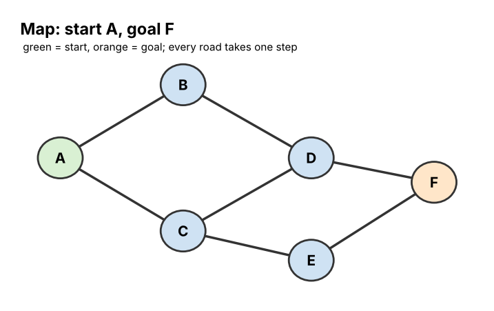
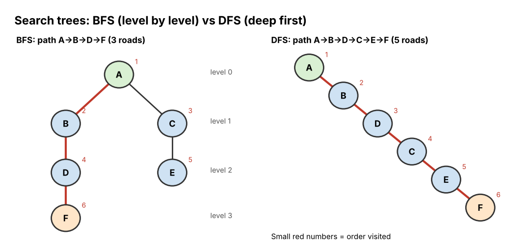

# 11 Planning and Search

**Chapter:** Chapter 4: Symbolic AI  
**Status:** Drafted (V2.0, 3 Nov 2026). Both searches on both maps were run with a short program and match the hand traces. Waiting for second-member review (see `tasks.md`, T16).  
**Owner / reviewer:** see `tasks.md` (T10)  
**Prerequisites:** Topic 05 (step-by-step algorithms), Topic 06 (stack, queue, tree, graph), Topic 09 (knowledge stored as nodes and links).  
**Draft note:** Prepared with Claude assistance (AI-use record AI-5). Every search order and path below was produced by code and compared with the hand trace.

## Learning Objectives

After this topic, a beginner can:

1. Describe a problem as **states**, **actions**, a **start state** and a **goal**.
2. Explain what a **state space** and a **search tree** are.
3. Carry out **breadth-first search (BFS)** and **depth-first search (DFS)** by hand on a small graph.
4. Compare BFS and DFS: which finds the shortest route, and which uses less memory.
5. Explain what a **plan** is in AI and give an everyday planning example.

## Explanation

### Problems as states and actions

Many AI problems are "get from here to there": find a route, solve a puzzle, plan a robot's moves. Symbolic AI describes them in a fixed way:

| Term | Meaning | Route example | Puzzle example (water jugs) |
|---|---|---|---|
| **State** | A snapshot of the situation | "I am in town C" | "4-litre jug has 2 L, 3-litre jug has 0 L" |
| **Start state** | Where we begin | Town A | Both jugs empty |
| **Action** | A move that changes one state into another | Drive along a road to a neighbouring town | Fill a jug, empty a jug, pour one into the other |
| **Goal** | The state (or test) we want to reach | Being in town F | Exactly 2 L in the 4-litre jug |
| **Path / solution** | A sequence of actions from start to goal | A → B → D → F | Fill, pour, … |

All the states and the actions linking them form a **state space**, which is a **graph** (Topic 06): states are nodes, actions are edges. **Search** means exploring this graph in a systematic way until a goal is found.

### Search tree and frontier

As the search explores, it builds a **search tree**: the start state is the root, and each node's children are the states reachable by one action. The **frontier** is the list of states found but **not yet explored**. The only difference between BFS and DFS is **which frontier state is explored next**:

| | **Breadth-first search (BFS)** | **Depth-first search (DFS)** |
|---|---|---|
| Explores next | The **oldest** state in the frontier | The **newest** state in the frontier |
| Frontier structure | **Queue** (FIFO) | **Stack** (LIFO) |
| Shape of exploration | Level by level: all places 1 step away, then 2 steps, … | Goes as deep as possible along one branch, then backs up |
| Finds the route with fewest steps? | **Yes** (always, if one exists) | **Not guaranteed** |
| Memory needed | Can be large: must remember a whole level | Usually small: remembers one branch |

**The general procedure** (with a "visited" list so no state is explored twice):

1. Put the start state in the frontier.
2. Take one state out of the frontier (BFS: the oldest; DFS: the newest).
3. If it is the goal, stop and trace the path back.
4. Otherwise add its **unvisited** neighbours to the frontier, remembering which state you came from.
5. If the frontier is empty, there is no solution. Otherwise go to step 2.

**Tie-break rule used in this module:** when several neighbours could be added, take them in **alphabetical order**. Without a fixed rule, different people get different (but still correct) orders.

### Planning

A **plan** is a sequence of actions that takes the world from the start state to a goal. **Planning** is search where the states describe the world using symbols, and each action has **preconditions** (what must be true before) and **effects** (what becomes true after). For example:

| Action | Preconditions | Effects |
|---|---|---|
| Boil water | have kettle, have water | water is hot |
| Make tea | water is hot, have tea bag, have cup | tea is ready |

Goal: *tea is ready*. A planner searches for actions whose effects achieve the goal and whose preconditions can be met: **Boil water → Make tea**. This is the same backward idea as backward chaining in Topic 10. The STRIPS planner (Fikes and Nilsson, 1971) used exactly this description, and planners like it are used in logistics, robotics and space missions.

## Worked Example: From A to F on a small map

*Figure 1. Roads (edges) between six towns (nodes). Start: A. Goal: F.*

Neighbours (alphabetical): A: B, C · B: A, D · C: A, D, E · D: B, C, F · E: C, F · F: D, E.

### Breadth-first search (frontier is a queue)

| Step | Take out | New unvisited neighbours added (came from) | Frontier queue afterwards (front → back) |
|---|---|---|---|
| 1 | A | B (A), C (A) | B, C |
| 2 | B | D (B) | C, D |
| 3 | C | E (C) — D already found | D, E |
| 4 | D | F (D) | E, F |
| 5 | E | none (C and F already found) | F |
| 6 | F | **Goal!** | – |

Visiting order: **A, B, C, D, E, F**. Trace back from F: F came from D, D from B, B from A. **Path: A → B → D → F (3 roads).** BFS guarantees no route with fewer roads exists.

### Depth-first search (always go deeper first)

Rule: from the current town, go to the first unvisited neighbour (alphabetical). If there is none, go back one step.

| Step | At | Unvisited neighbours | Move to |
|---|---|---|---|
| 1 | A | B, C | B |
| 2 | B | D | D |
| 3 | D | C, F | C |
| 4 | C | E | E |
| 5 | E | F | F → **Goal!** |

Visiting order: **A, B, D, C, E, F**. **Path: A → B → D → C → E → F (5 roads).** DFS found *a* route quickly with little memory, but not the shortest one: at D it went to C (alphabetically first) instead of F, which was right next to it.

*Figure 2. The search trees. BFS explores level by level; DFS dives down one branch.*

## Activity

Use this new map. Start: **S**. Goal: **G**. Roads: S–A, S–B, A–C, A–D, B–G, C–D, D–G.

Neighbours (alphabetical): S: A, B · A: C, D, S · B: G, S · C: A, D · D: A, C, G · G: B, D.

1. **BFS.** Run breadth-first search. Write a table like the worked example (take out, added, queue). Give the visiting order and the path found.
2. **DFS.** Run depth-first search with the alphabetical rule. Give the visiting order and the path found.
3. **Compare.** Which method found the shorter route? Explain why, using the words *queue*, *stack* and *level*.
4. **State the problem.** Describe the problem "a student must get from the dormitory to the exam hall by bus or on foot" in terms of states, actions, start state and goal.
5. **Plan.** Using preconditions and effects, write two actions that achieve the goal *essay submitted*, starting from *have notes*. Then write the plan.

## Answer

1. 

   | Step | Take out | Added (came from) | Queue afterwards |
   |---|---|---|---|
   | 1 | S | A (S), B (S) | A, B |
   | 2 | A | C (A), D (A) | B, C, D |
   | 3 | B | G (B) | C, D, G |
   | 4 | C | none | D, G |
   | 5 | D | none (G already found) | G |
   | 6 | G | **Goal** | – |

   Visiting order: **S, A, B, C, D, G**. Path (trace back G ← B ← S): **S → B → G (2 roads).**
2. S → A (first neighbour) → C (A's first unvisited) → D (C's only unvisited) → G (D's unvisited). Visiting order: **S, A, C, D, G**. Path: **S → A → C → D → G (4 roads).**
3. **BFS** found the shorter route (2 roads vs 4). BFS uses a **queue**, so it finishes every place one road from S (A and B) before any place two roads away; G is at **level** 2, so it is found by the shortest route. DFS uses a **stack** (always the newest place), so it went deep along A → C → D before ever trying B.
4. States: the student's location (dormitory, bus stop, road junctions, exam hall) — and possibly the time. Actions: walk to a neighbouring place; take a bus between two stops. Start state: at the dormitory. Goal: at the exam hall (perhaps "before 9:00").
5. Example: **Write essay** — preconditions: have notes; effects: essay written. **Submit essay** — preconditions: essay written, have internet; effects: essay submitted. Plan: **Write essay → Submit essay** (assuming "have internet" is true at the start). Any pair where the first action's effect provides the second action's precondition is correct.

## Common Misunderstandings

- *"DFS is wrong because it found a long route."* DFS is a correct search method; it finds *a* solution, just not always the shortest. Its strength is low memory.
- *"Search means looking through a list, like Topic 05."* Here search explores a **graph of states**, where each step creates new possibilities.
- *"The computer can see the whole map at once and pick the best route."* A search procedure only knows the states it has explored so far; that is why the order of exploration matters.

## Quick Self-Check

1. Which data structure holds the frontier in BFS? In DFS? *(Queue; stack.)*
2. Which method guarantees the route with the fewest steps? *(BFS.)*
3. In planning, what must be true before an action can be used? *(Its preconditions.)*

## How This Topic Will Be Reused

- **Study Guide / Test Bank:** chapter "Planning and Search"; BFS/DFS trace questions on new maps; states/actions/goal questions.
- **PPT Slides:** state-space terms table, Figure 1, BFS queue table step by step, DFS table, Figure 2.
- **Video Tutorial:** "Search through a state space" (planned tutorial 4): BFS and DFS on the A–F map, side by side.

## References

1. Russell, S., & Norvig, P. (2021). *Artificial Intelligence: A Modern Approach* (4th ed.). Pearson. (Chapter 3: problem formulation, BFS and DFS; Chapter 11: classical planning.)
2. Fikes, R. E., & Nilsson, N. J. (1971). STRIPS: A new approach to the application of theorem proving to problem solving. *Artificial Intelligence, 2*(3–4), 189–208.
3. Foundations of CS & AI 2026, Chapter 3 course slides (sample learning material "BFS") and Chapter 4 course slides.

*Both maps and the planning examples are the team's own.*
