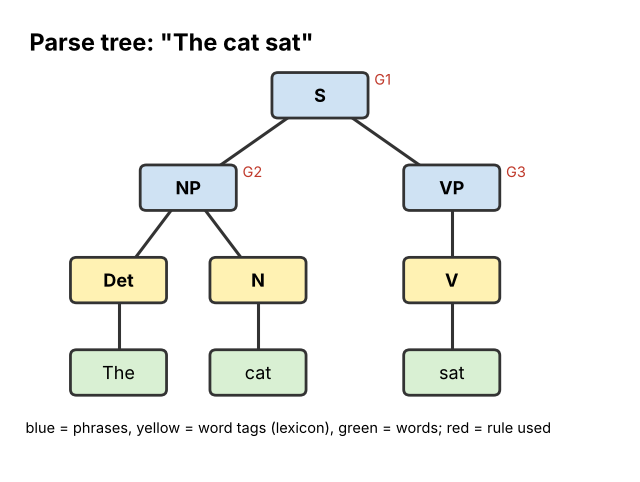

# 12 Symbolic NLP

**Chapter:** Chapter 4: Symbolic AI  
**Status:** Drafted (V2.0, 3 Nov 2026). The grammar and the chatbot rules were tested with a short program. Waiting for second-member review (see `tasks.md`, T16).  
**Owner / reviewer:** see `tasks.md` (T10)  
**Prerequisites:** Topic 06 (trees), Topic 08 (rules), Topic 09 (symbols).  
**Depth:** Brief introduction (B) as agreed in the project plan.  
**Draft note:** Prepared with Claude assistance (AI-use record AI-5). The parses and chatbot replies below were produced by code and compared with the hand traces.

## Learning Objectives

After this topic, a beginner can:

1. Explain what **natural language processing (NLP)** is and why language is hard for computers.
2. Describe the steps **tokenisation**, **tagging** and **parsing**.
3. Use a small set of **grammar rules** to build a **parse tree** for a short sentence, and decide whether a sentence is grammatical under those rules.
4. Explain how a **rule-based chatbot** chooses a reply, and find a question it cannot handle.

## Explanation

### What is NLP?

A **natural language** is a language people speak, such as English, Mongolian or Chinese, as opposed to a programming language (Topic 02). **Natural language processing (NLP)** is the part of AI that lets computers work with human language: translation, search engines, spell-checkers, voice assistants, chatbots.

Language is hard for computers because it is **ambiguous**: one sentence can have several meanings. "I saw the man with the telescope" — who has the telescope? People use context and common sense; a program must be told how to decide.

**Symbolic NLP** handles language with hand-written **rules**: dictionaries of words and grammar rules written by linguists. (Modern systems such as ChatGPT are mostly data-driven, learning from huge amounts of text; see Topic 07.)

### Three basic steps

| Step | What it does | "The cat sat." |
|---|---|---|
| **Tokenisation** | Split the text into words and punctuation (**tokens**) | `The` · `cat` · `sat` · `.` |
| **Tagging** | Label each token with its **part of speech** using a **lexicon** (a word list) | The = Det (determiner), cat = N (noun), sat = V (verb) |
| **Parsing** | Use **grammar rules** to group the words into phrases and build a **parse tree** | see below |

### Grammar rules

A **grammar** is a set of rules saying how smaller parts combine into bigger ones. The arrow → means "is made of".

| Rule | Meaning |
|---|---|
| G1: S → NP VP | A **sentence** is a noun phrase followed by a verb phrase |
| G2: NP → Det N | A **noun phrase** is a determiner followed by a noun ("the cat") |
| G3: VP → V | A **verb phrase** can be just a verb ("sat") |

**Lexicon:** Det: *the, a* · N: *cat, dog, mat* · V: *sat, slept*

**Parsing** means finding a way to apply the rules so that the whole sentence becomes one **S**. If no way exists, the sentence is **not grammatical** under this grammar. The result is drawn as a **parse tree** (a tree from Topic 06): S at the root, words at the leaves.

## Worked Example: Parsing "The cat sat"

1. **Tokenise:** `The` `cat` `sat`.
2. **Tag with the lexicon:** The → Det, cat → N, sat → V. Sequence: **Det N V**.
3. **Apply G2 (NP → Det N):** "The cat" becomes an NP. Sequence: **NP V**.
4. **Apply G3 (VP → V):** "sat" becomes a VP. Sequence: **NP VP**.
5. **Apply G1 (S → NP VP):** the whole thing becomes **S**. Parsing succeeds.

*Figure 1. The parse tree. Reading the leaves left to right gives the sentence; each branching point is one grammar rule.*

**A failing example:** "Cat the sat" → tags **N Det V**. G2 needs Det *before* N, so no NP can be formed, and G1 can never apply. The parser rejects the sentence. Notice that the program does not "understand" anything; it only checks that the symbols fit the rules, exactly like the rule matching in Topic 10.

### Rule-based chatbots

A simple **chatbot** uses **pattern → response** rules: if the user's message contains a keyword (pattern), give the matching reply. The most famous early example is **ELIZA** (Joseph Weizenbaum, MIT, 1966), which imitated a therapist by turning the user's words back into questions ("I feel sad" → "Why do you feel sad?"). Many people felt ELIZA understood them, although it only matched patterns.

**Example: a canteen help bot**

| Rule | IF the message contains | THEN reply |
|---|---|---|
| C1 | "open" or "hours" | "The canteen is open 7:00–20:00." |
| C2 | "menu" or "food" | "Today's menu is on the screen by the door." |
| C3 | "pay" or "card" | "You can pay with your student card or WeChat Pay." |
| Default | (nothing matched) | "Sorry, I don't understand. Please ask staff." |

The bot checks the rules **in order** and uses the **first** one that matches.

- "What are your opening hours?" → contains "open" → **C1**.
- "Can I pay by card?" → contains "pay" → **C3**.
- "Is the food open to visitors?" → contains "open" → **C1** fires first, giving the opening hours, which is the wrong answer. The bot matched words, not meaning.

### Strengths and limits of symbolic NLP

| Strengths | Limits |
|---|---|
| Predictable and explainable: you can see which rule fired | Real language has far too many patterns to write by hand |
| Works with little data; good for narrow, fixed tasks (form filling, command words, grammar checkers) | Brittle: spelling mistakes, slang and new phrasing break it |
| Easy to correct one specific error by editing a rule | Keywords ignore meaning, negation and context ("I do **not** want to pay") |

## Activity

1. **Parse.** Using G1–G3 and the lexicon, parse **"A dog slept"**. Write the tag sequence and each rule applied. Is it grammatical?
2. **Predict.** Is **"The mat sat"** accepted by the grammar? Is it sensible? What does this tell you about grammar rules?
3. **Extend the grammar.** The sentence **"The cat sat on the mat"** is rejected by G1–G3. Add the word *on* to the lexicon as P (preposition) and write two new rules so that it can be parsed. Then list the rules used.
4. **Write a chatbot.** Write three keyword rules (plus a default) for a **library help chatbot**. Then write one sensible question that your bot will answer **wrongly** or not at all, and explain why.
5. **Find the error.** Using the canteen bot, what reply does "I don't want to pay by card, can I use cash?" get? Why is that a problem?

## Answer

1. Tags: A → Det, dog → N, slept → V: **Det N V**. G2: "A dog" → NP. G3: "slept" → VP. G1: NP VP → S. **Grammatical.**
2. **Yes**, it is accepted: The → Det, mat → N, sat → V, and G2, G3, G1 apply. But it is **not sensible** (a mat cannot sit). Grammar rules check **structure** (syntax), not **meaning** (semantics). Handling meaning needs extra knowledge, such as "only animals and people can sit" — the kind of knowledge from Topic 09.
3. Add **G4: VP → V PP** (a verb phrase can be a verb followed by a prepositional phrase) and **G5: PP → P NP** (a prepositional phrase is a preposition followed by a noun phrase). Parse: The cat → NP (G2); the mat → NP (G2); on + NP → PP (G5); sat + PP → VP (G4); NP + VP → S (G1). Rules used: **G2, G2, G5, G4, G1**.
4. Example: L1: "borrow" or "loan" → "You can borrow up to 5 books for 3 weeks." L2: "open" or "hours" → "The library is open 8:00–22:00." L3: "print" → "Printers are on the 2nd floor." Default → "Please ask at the front desk." Question it fails: "How long can I **keep** a book?" has no keyword, so it gets the default reply even though L1 holds the answer (a different word for the same meaning). Or "Is the printer open on Sunday?" fires L2 (opening hours of the library), not printing information. Any example with a clear explanation of the keyword problem is correct.
5. "pay" is found first → **C3**: "You can pay with your student card or WeChat Pay." It ignores the negation "don't" and never answers the real question about cash. Keyword matching does not understand meaning.

## Common Misunderstandings

- *"If the parser accepts a sentence, the computer understands it."* Parsing only checks structure. Understanding needs meaning and world knowledge.
- *"Chatbots like ELIZA think."* ELIZA only matched patterns and filled in templates; the feeling of being understood came from the human user.
- *"Symbolic NLP is no longer used."* Rule-based methods are still used where predictability matters, such as grammar checkers, form parsers and voice commands with a fixed vocabulary, often alongside data-driven models.

## Quick Self-Check

1. What is the step that splits text into words called? *(Tokenisation.)*
2. In the rule S → NP VP, what does NP stand for? *(Noun phrase.)*
3. Why did "Is the food open to visitors?" get the wrong reply? *(The bot matched the keyword "open", not the meaning.)*

## How This Topic Will Be Reused

- **Study Guide / Test Bank:** short chapter; parsing questions and "find the chatbot failure" questions.
- **PPT Slides:** three-steps table, grammar rules, Figure 1 parse tree built step by step, canteen bot table.
- **Video Tutorial:** not selected for video (brief topic).

## References

1. Jurafsky, D., & Martin, J. H. (2024). *Speech and Language Processing* (3rd ed. draft). https://web.stanford.edu/~jurafsky/slp3/ (Tokenisation, parts of speech, context-free grammars, parsing, chatbots and ELIZA.)
2. Weizenbaum, J. (1966). ELIZA—a computer program for the study of natural language communication between man and machine. *Communications of the ACM, 9*(1), 36–45.
3. Russell, S., & Norvig, P. (2021). *Artificial Intelligence: A Modern Approach* (4th ed.). Pearson. (Chapter on natural language processing: grammars and parsing.)
4. Foundations of CS & AI 2026, Chapter 4 course slides.

*The grammar, sentences, canteen bot and library bot are the team's own examples.*
