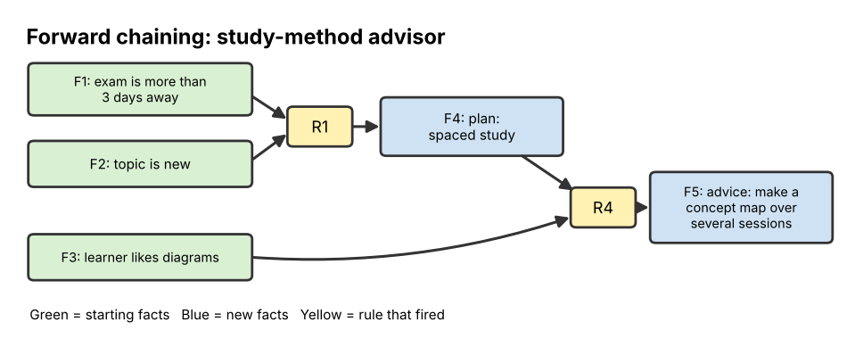

# 13 Hands-on and Review

**Chapter:** Chapter 4: Symbolic AI  
**Status:** Drafted (V2.0, 3 Nov 2026). The advisor's forward and backward chaining runs were checked with a short program. Waiting for second-member review (see `tasks.md`, T16).  
**Owner / reviewer:** see `tasks.md` (T10)  
**Prerequisites:** Topics 07–12 (and the whole module for the review quiz).  
**Depth:** Brief introduction (B) plus a hands-on project and a whole-module review.  
**Draft note:** Prepared with Claude assistance (AI-use record AI-5). The rule runs were produced by code and compared with the hand traces.

## Learning Objectives

After this topic, a beginner can:

1. Build a small **rule-based advisor** on paper: choose facts, write rules, and run forward and backward chaining.
2. Find and fix a **gap** in a knowledge base.
3. Discuss real **applications**, **advantages** and **limits** of Symbolic AI, and decide when it is a good choice.
4. Check their understanding of the whole module with a review quiz.

## Explanation

### Building a rule-based system in five steps

This brings together Topics 08 (IF-THEN logic), 09 (facts and symbols) and 10 (forward and backward chaining).

1. **Choose a narrow question.** Expert systems only work in a small domain. Example: *Which study method should I use tonight?*
2. **List the facts the user can supply.** Each must be checkable as true or false: "exam is within 3 days", "topic is new to me".
3. **Write IF-THEN rules.** Use **intermediate conclusions** (like "plan: final review") so rules can chain, just as "no power reaches the laptop" did in Topic 10.
4. **Run it.** Use forward chaining to see what the facts lead to, and backward chaining to check one particular piece of advice.
5. **Test and fix.** Try different combinations of facts. Where no advice comes out, the knowledge base has a **gap**; add a rule.

### Where Symbolic AI is used today

| Area | Example | Why symbolic methods fit |
|---|---|---|
| Rules set by law or policy | Tax calculators, benefit-eligibility checkers, insurance claim rules | The rules already exist in writing and every decision must be explainable |
| Configuration | Checking that a computer order or a car's options fit together (as XCON did) | Many exact compatibility rules |
| Route finding and planning | GPS route search, delivery scheduling, timetabling, space-mission planning | Search over states and actions (Topic 11) |
| Games | Chess engines' search, game characters following rules | Clear rules and a clear goal |
| Checking correctness | Tools that prove a chip design or a program meets its specification | Logic gives guaranteed answers |
| Language tools | Grammar checkers, voice commands with a fixed vocabulary | Narrow, predictable language (Topic 12) |
| Hybrid AI | AlphaGo's tree search, chatbots that call a rule-based calculator or database | Combines learning with exact reasoning |

### Advantages and limits (summary of Chapter 4)

| Advantages | Limits |
|---|---|
| **Explainable:** can show the rules and steps behind an answer (Topics 10, 11) | **Knowledge bottleneck:** experts must write every rule by hand (Topic 10) |
| **Exact and consistent:** same facts → same answer; logic is checkable (Topic 08) | **Brittle:** fails outside its rules or with a missing rule (Topics 07, 10) |
| **Needs no training data** | **Poor with messy input:** images, speech, handwriting, slang (Topic 12) |
| **Easy to correct:** edit one rule | **Hard to maintain** when rules number in the thousands and start to conflict |
| **Good at search and planning** with clear rules (Topic 11) | **Search can explode:** large state spaces have too many states to explore |

**When to choose Symbolic AI — a checklist.** It is a good choice when most of these are true: the domain is narrow; experts can state the rules; decisions must be explained or audited; there is little training data; the input is already clean symbols (yes/no answers, numbers, database fields). If the input is raw images or free text, or nobody can state the rules, data-driven AI (or a hybrid) is usually better.

## Worked Example: A six-rule study-method advisor

*These rules are a practice example for reasoning, not tested study advice.*

**Knowledge base**

| Rule | IF | THEN |
|---|---|---|
| R1 | exam is more than 3 days away AND topic is new | plan: spaced study |
| R2 | exam is within 3 days AND topic is familiar | plan: final review |
| R3 | exam is within 3 days AND topic is new | plan: focus on key points |
| R4 | plan: spaced study AND learner likes diagrams | advice: make a concept map over several short sessions |
| R5 | plan: final review | advice: do practice questions from past tests |
| R6 | plan: focus on key points AND studying with friends | advice: teach each other the main ideas |

**Facts (working memory at the start):** F1 exam is more than 3 days away · F2 topic is new · F3 learner likes diagrams.

**Forward chaining**

| Cycle | Rules whose conditions are all true | Rule fired | New fact |
|---|---|---|---|
| 1 | R1 (F1, F2). R2 and R3 fail: the exam is not within 3 days | R1 | F4: plan: spaced study |
| 2 | R4 (F4, F3) | R4 | F5: advice: make a concept map over several short sessions |
| 3 | None left | Stop | — |

*Figure 1. The rule chain: starting facts (green) → rule (yellow) → new facts (blue).*

**Backward chaining — goal: "advice: make a concept map over several short sessions".**

1. R4 concludes it. Sub-goals: **plan: spaced study** and **learner likes diagrams**.
2. "Learner likes diagrams" is a fact (F3) ✔.
3. "Plan: spaced study" is not a fact; R1 concludes it. Sub-goals: **exam is more than 3 days away** (F1 ✔) and **topic is new** (F2 ✔).
4. All sub-goals proved → the goal is proved.

## Activity

### Part A: Hands-on with the advisor

1. **Run forward chaining.** New user: exam is **within 3 days**, topic is **new**, studying **alone**. Which rules fire? What advice is given?
2. **Fix the gap.** Write a rule R7 so that the user in question 1 gets advice. Run forward chaining again.
3. **Backward chaining.** Facts: exam is within 3 days, topic is familiar. Test the goal "advice: do practice questions from past tests". Write each sub-goal.
4. **Build your own.** Choose a new narrow question (for example, *Which transport should I take to the city centre?*). Write at least four facts and five rules, with at least one intermediate conclusion. Run forward chaining for one set of facts, and swap with a classmate to test each other's systems.

### Part B: Module review quiz

*Chapter 3: Software & Algorithms*

1. (Topic 01) Is Weixin system or application software? Name the OS job that shares the CPU between Weixin and a music app.
2. (Topic 02) What does this print? `x = 2` · `for i in range(3):` · `    x = x * 2` · `print(x)`
3. (Topic 03) A bug is found by real users only after release. Which testing level should have found that the app does not meet their needs?
4. (Topic 04) Using the Students table in Topic 04, what does `SELECT name FROM Students WHERE year = 2;` return?
5. (Topic 05) How many checks does binary search need, at most, for a sorted list of 1,000 items?
6. (Topic 06) Which structure suits customers waiting for a help-desk chat, and why?

*Chapter 4: Symbolic AI*

7. (Topic 07) Give one advantage of Symbolic AI over data-driven AI and one disadvantage.
8. (Topic 08) Rule: IF it is a weekend THEN the library opens at 10:00. Fact: the library opens at 10:00. Can you conclude it is a weekend? Name the pattern.
9. (Topic 09) Using the semantic network in Topic 09, does a canary breathe? Show the inheritance path.
10. (Topic 10) What is the difference in direction between forward and backward chaining?
11. (Topic 11) Which search method uses a queue, and what does that guarantee?
12. (Topic 12) Why can a grammar accept "The mat sat" even though it makes no sense?

### Part C: Reflection

Write three to five sentences: *Describe one problem in your own life or major where Symbolic AI would work well and one where it would not. Use at least two items from the "when to choose Symbolic AI" checklist.*

## Answer

### Part A

1. R1 fails (the exam is not more than 3 days away). R2 fails (topic not familiar). **R3 fires** → plan: focus on key points. R6 needs "studying with friends", which is not a fact, so it fails. **No advice is given**: a gap in the knowledge base, like Activity 1 in Topic 10.
2. Example: **R7: IF plan: focus on key points AND studying alone THEN advice: make a one-page summary and test yourself on it.** Now R3 fires, then R7 fires and gives advice. Any rule that links "plan: focus on key points" (with or without "studying alone") to a sensible action is acceptable.
3. Goal → R5 → sub-goal **plan: final review** → R2 → sub-goals **exam is within 3 days** ✔ and **topic is familiar** ✔. All proved, so the advice is given.
4. Open answer. A good answer: (a) facts are checkable as true/false; (b) every rule has IF conditions and one THEN conclusion; (c) at least one rule's conclusion is used as another rule's condition; (d) the forward-chaining table shows each cycle, the rule fired and the new fact; (e) the classmate's test either produced advice or revealed a gap that was then fixed.

### Part B

1. **Application** software. **Process management** (CPU scheduling).
2. 2 → 4 → 8 → 16. Prints **16**.
3. **Acceptance testing** (and, earlier, a better requirements stage).
4. **Bat** and **Chen**.
5. **10** checks.
6. A **queue**: first come, first served is fair (FIFO).
7. Advantage: it can **explain** its answers / needs no training data. Disadvantage: rules must be **written by hand** / it is **brittle** with messy input or missing rules.
8. **No.** The library might open at 10:00 on a holiday, too. This is **affirming the consequent**, an invalid pattern.
9. **Yes.** Canary → Bird → Animal; Animal stores "can: breathe", and the canary inherits it.
10. Forward chaining goes from **facts to conclusions** (data-driven); backward chaining starts from a **goal** and works back to the facts (goal-driven).
11. **Breadth-first search.** It explores level by level, so it finds a route with the **fewest steps**.
12. Grammar rules check **structure** (syntax), not **meaning** (semantics). "The mat sat" has the correct pattern Det N V.

### Part C

Open answer. A strong reflection names a specific problem, links it to checklist items (narrow domain, rules can be stated, explanations needed, little data, clean symbolic input) and explains why the other problem fails the checklist (e.g. recognising plant diseases from photos: messy image input and rules hard to state, so data-driven AI fits better).

## Common Misunderstandings

- *"A bigger knowledge base is always better."* More rules mean more possible conflicts and harder maintenance. A small, tested rule set in a narrow domain often works better.
- *"Symbolic AI and machine learning are rivals; you must pick one."* Many successful systems are hybrids that use each for what it does best.

## Quick Self-Check

1. What do you call a situation where no rule produces advice for a valid set of facts? *(A gap in the knowledge base.)*
2. Name two kinds of task where Symbolic AI is a good choice. *(Any two: rule/law checking, configuration, route finding/planning, games with clear rules, correctness checking, fixed-vocabulary language tools.)*

## How This Topic Will Be Reused

- **Study Guide / Test Bank:** final chapter; Part B questions seed the cumulative test bank (each tagged with its source topic).
- **PPT Slides:** five-step build method, study-advisor rules and Figure 1, applications table, advantages/limits table, checklist.
- **Video Tutorial:** not selected as a separate video; the advisor run may close tutorial 3 ("How a rule-based expert system reaches a conclusion") as a second example.
- **Live mini lecture:** the advisor is a backup in-class activity (the class acts as the inference engine).

## References

1. Russell, S., & Norvig, P. (2021). *Artificial Intelligence: A Modern Approach* (4th ed.). Pearson. (Applications and limits of knowledge-based systems; planning.)
2. Jackson, P. (1998). *Introduction to Expert Systems* (3rd ed.). Addison-Wesley. (Building and testing a knowledge base.)
3. Dunlosky, J., Rawson, K. A., Marsh, E. J., Nathan, M. J., & Willingham, D. T. (2013). Improving students' learning with effective learning techniques. *Psychological Science in the Public Interest, 14*(1), 4–58. (Background for the study-method example: spaced and practice-test techniques.)
4. Foundations of CS & AI 2026, Chapter 3 and Chapter 4 course slides.

*The study-method advisor, quiz questions and reflection task are the team's own.*
